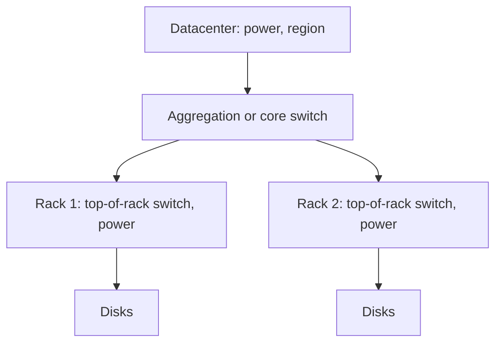

# Datacenter Systems: Quantitative Availability

This note makes [[Datacenter Systems/Course Introduction and Overview/Availability, Tail Latency, and PUE Formulas|availability]] quantitative. It starts with how availability is measured and promised (**SLI**, **SLO**, **SLA**), looks at why 100% availability is unreachable (Tandem and Google experience), shows how the **error budget** turns that into an engineering policy, and then asks what happens to availability when storage is spread over a fleet: the **MTTSF** calculation, recovery time of distributed data, failure domains, and the replication and erasure coding strategies used in practice.

---

## Availability

- **Availability** is the fraction of time a service is able to answer your request.
- It is approximated using:
  - **MTTF**: mean time to device failure.
  - **MTTR**: mean time to repair a device.
- We approximate it from the time between failures versus the time it takes to repair a device. Once enough failure and repair times have been accumulated, we can compute the mean of each and plug them into the equation in [[#Formal Analysis]].

---

## Service Level Terminology

- **Service Level Indicator (SLI)**: quantifiable metrics for availability, performance, and quality.
  - Example: 97% of all requests succeed.
  - Example: 90% of all requests finish within 200ms.
- **Service Level Objective (SLO)**: the expectations for a service, what will keep customers happy.
  - It is a contract with the customer that states what counts as good service.
  - Example: 90% within 200ms, 99% within 400ms, 99.9% within 800ms. The further into the tail, the higher the latency allowed.
- **Service Level Agreement (SLA)**: the payment to the customer if the SLO is not met.

---

## An Early Example: The Tandem Non-Stop

Jim Gray's study, "Why do computers stop and what can be done about it?", is a retrospective of every failure of a "non-stop" system. Tandem was a replicated database with high-availability goals.

Lessons:

- **100% availability was not achieved.**
- **Primary/backup is no guarantee.** The backup should pick up if the primary fails, which makes the system more available, but it does not reach 100%.
- **Humans in the loop make things worse.**
  - Primary and backup may drift apart because of human error.
  - Errors cascade because the backup is not a 100% copy.
- Hardware, software, sysadmin, power outages, and more all contributed.

---

## Google Experience

From the Google SRE workbook (sre.google/workbook):

- **100% reliability is not possible.**
  - Customers would not be able to tell even if you achieved it.
  - Much is out of our control: even if we fix everything inside our datacenter, customers will still blame us for failures that were not our fault.
- **Tension between reliability and future development.**
  - Devote 70% of the downtime budget to reliability; this is within Google's standard of being perfectly reliable.
  - If we did well on availability last quarter, we can roll out a feature; if not, we work more on reliability before rolling it out.
  - If a team is better at managing reliability, it can afford to be more agile.
- **Dependencies need more nines.** If a service depends on another, the dependee must be 10x more reliable. To build a 99.99% service, its components must be 99.999%.
- **Outage frequency times MTTR limits availability.** With humans in the loop on failures, MTTR will be too large.

### Error Budget

The **error budget** is the number of requests that miss the SLO in a time window.

- The typical window is 4 weeks (13 weeks for a more stable service).
- If you exceed the error budget over the time window:
  - Stop releasing new features until it replenishes.
  - Redesign operational procedures to reduce problems.

Example:

- A server gets 1M requests/day.
- SLO: 99.9% of requests in under 200ms.
- The error budget is 1K late requests/day, or 28K late requests over the last 4 weeks.

---

## Storage Devices

- The failure rate of an HDD follows a **bathtub curve**: a burn-in period of early failures, a flat middle, and a wear-out period at the end of life.

---

## Mean Time to System Failure (MTTSF)

What if we disaggregate storage, so that a particular user's data is spread over a number of devices?

- The SLO is data unavailability, and maybe also some performance bound.
- Other services depend on storage availability, so higher availability is needed.
- $\text{MTTSF} = \text{device MTTF} / \text{number of devices}$, because any one device failing is enough.

With a device MTTF of 2.5M hours:

| Data placement | MTTSF |
| :--- | :--- |
| On one disk | 2.5M hours |
| Spread over 10 disks | 250K hours |
| Spread over a fleet of 1M disks | 2.5 hours |

- **Mirroring** data on $n$ disks changes the condition: data is lost only with a failure plus another failure during the recovery period.

---

## Recovery of Distributed Data

Data is spread over $k$ disks, with two copies of every data block.

- The system MTTF is MTTF$/k$, as above.
- MTTR is limited by how much bandwidth the recovery can use:

$$\text{MTTR} = \frac{\text{data per disk}}{\text{disk bandwidth} \times k \times \text{fraction of spare disk bandwidth}}$$

The more disks that participate in recovery, the more bandwidth, and the better. Spreading replicas widely shrinks the window in which a second failure causes data loss.

---

## Impact of Failure Domain

Devices do not fail independently; they fail together with whatever they share.

- **Network failure at the rack level**: all disks in that rack become unavailable.
  - Mirror data across racks.
- **Network failure at an aggregation or core switch**:
  - Use redundant switches above the rack level. An aggregation switch interconnects entire sets of racks.
  - What if we lose both? Replicate across the cluster?
- **Power failure at the rack, aggregation, or datacenter level**:
  - We do not want regional datacenters to affect each other.

---

## Replication Strategies

In a large fleet, simple mirroring runs a high risk of data loss.

### For Actively Modified Data (SLC SSDs)

- Spread data blocks across a fleet of disks.
- Keep **three copies** of each data block in different failure domains (different racks, power supplies, and so on).
- Spread replicas across different racks for faster failure recovery.
- On a disk, network, or power failure, use the replicas in parallel to restore the extra copy.

### For Colder Data

- First, **compress** the data to reduce space.
- **Recode** the data using Reed-Solomon or another erasure code:
  - It allows recovery of missing data from the remaining blocks.
  - Stripe the data into $j$ blocks with $k$ redundancy blocks; it survives any $k$ failures.
- Cloud storage needs more resilience than a single parity block:
  - **Google**: (6, 3). Stripe data into 6 chunks over 9 disks; survives 3 failures.
  - **Azure**: (12, 4). Stripe 12 chunks over 16 disks; survives 4 failures.
- To store a 1.2MB (compressed) file in Azure, turn it into 16 writes of 100KB on 16 different disks (12 data chunks plus 4 redundancy chunks).

---

## Formal Analysis

### Availability

#### Formal Definition

$$\text{Availability} = \frac{\text{MTTF}}{\text{MTTF} + \text{MTTR}}$$

#### Simplified Explanation

Availability is the fraction of a device's life that it is up: the time it works, divided by the time it works plus the time it takes to fix.

### Error Budget

#### Formal Definition

$$\text{Budget} = N_{\text{requests}} \times (1 - \text{SLO}), \qquad 10^6 \times (1 - 0.999) = 1000 \text{ per day}, \quad 1000 \times 28 = 28\text{K per 4 weeks}$$

#### Simplified Explanation

The SLO says how many requests are allowed to be bad; the budget is that allowance, spent by failures and replenished as the window slides.

### MTTSF and Recovery

#### Formal Definition

$$\text{MTTSF} = \frac{\text{MTTF}_{\text{device}}}{n}, \qquad \text{MTTR} = \frac{D_{\text{per disk}}}{B_{\text{disk}} \times k \times f_{\text{spare}}}$$

#### Simplified Explanation

With $n$ devices, something breaks $n$ times as often. Recovery is fast when many disks each copy a small piece in parallel.

### Erasure Coding $(j, k)$

#### Formal Definition

$$\text{Disks used} = j + k, \qquad \text{failures tolerated} = k, \qquad \text{overhead} = \frac{j + k}{j}$$

Google (6, 3): 9 disks, tolerates 3, overhead 1.5x. Azure (12, 4): 16 disks, tolerates 4, overhead 1.33x.

#### Simplified Explanation

Any $j$ of the $j + k$ pieces are enough to rebuild the file, so you can lose $k$ pieces and still get your data back for much less space than three full copies.

---

## Related

- [[Datacenter Systems/Course Introduction and Overview/Availability, Tail Latency, and PUE Formulas|Availability, Tail Latency, and PUE Formulas]]: the introductory availability formulation
- [[Datacenter Systems/Course Introduction and Overview/Failure Modes|Failure Modes]]: stragglers, resource stranding, and incast
- [[Datacenter Systems/Server Memory Systems/HDDs|HDDs]]: the cold storage tier these codes protect
- [[Datacenter Systems/Server Memory Systems/SSD|SSD]]: the SLC tier used for actively modified data
- [[Distributed Systems/Index|CSE452: Distributed Systems]]: replication and consensus

## Industry Standard Terms

- **MTTF** → mean time to failure (MTBF when repairable)
- **MTTSF** → mean time to data loss (MTTDL)
- **Error budget** → SRE error budget
- **Failure domain** → fault domain / availability zone
- **Reed-Solomon (j, k)** → erasure coding (data shards, parity shards)
- **Recovery bandwidth** → rebuild / re-replication bandwidth
