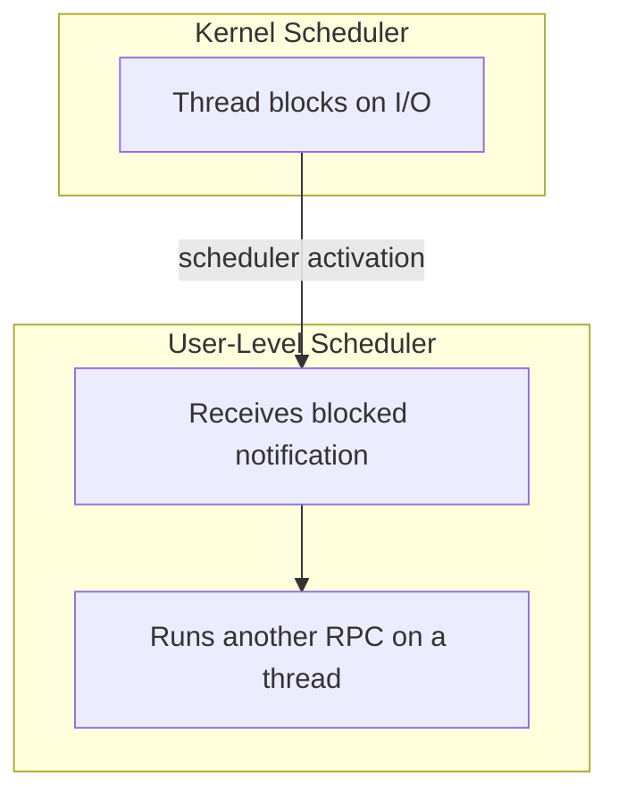

# Datacenter Systems: Queueing and CPU Scheduling

This note extends [[Datacenter Systems/Queuing Theory|Queuing Theory]] from a single queue to realistic systems: several resources in sequence, several servers behind a load balancer, several cores pulling threads, and several layers of schedulers stacked on top of each other. It first derives where the bottleneck is, then asks how requests should be distributed to multiple servers, then how cores should balance threads, then how queue-service policy shapes latency, and finally how scheduling at different levels interacts.

---

## Response Time and Bottlenecks

The most common arrival distribution is the **Poisson / exponential distribution**.

![[Screenshots/Poisson Distribution Response Time vs Utilization.png]]

For a single resource under this model:

$$R = \frac{S}{1 - U}$$

- $R$ is the response time, $S$ is the service time, and $U$ is the utilization.
- At low utilization ($U \to 0$), $R = S$: requests almost never wait.
- As utilization approaches 1, the denominator approaches 0 and response time goes to infinity.

### Multiple Resources in Sequence

A request usually touches several resources one after another (CPU, disk, network). The CPU is not one queue; it is one of many queues a request passes through, so the whole system is modeled as a network of services.

![[Screenshots/CPU and IO Response Time.png]]

$$R = \sum_i \frac{S_i}{1 - U_i}$$

- $S_i$ is the service time of resource $i$ and $U_i$ is its utilization.
- The term with the highest utilization dominates the sum, because it grows without bound as $U_i \to 1$.
- **Implication**: if you fix one bottleneck, the resource with the next-highest utilization limits performance. There is always exactly one bottleneck for a given set of requests.
- System performance analysts use this to find the bottleneck across all devices and services a set of requests goes through. The analysis can be taken as deep as needed (down to individual queues), then the bottleneck item is fixed.

---

## Multiple Servers: Where Should Requests Queue?

With multiple servers we can spread requests across them to reduce response time. The design question is the same as at supermarket checkout counters:

- Should all requests line up at the front, and a server grabs the next one as it becomes ready (**single shared queue**)?
- Should each service point have its own queue, with the request waiting there until its server is ready (**per-server queues**)?

![[Screenshots/Multiprocessor Queues.png]]

| | Single shared queue (left) | Per-server queues (right) |
| :--- | :--- | :--- |
| Placement decision | None; a job is taken when a server is ready | Must be made early, when the request arrives |
| Blocking | A job is never stuck behind a busy server | A job can wait behind a slow one while another server idles |
| Cost | Every server pulls from the same queue, so it needs **synchronization** | Needs smart scheduling to place requests, and that decision can be heavy |

The synchronization cost is the same problem a CPU has when it goes idle: the scheduler must take the next job from a shared run queue, which requires locks.

---

## Load Balancers

Load balancing is a big practical problem in servers (the OS scheduler or an RPC scheduler).

### Why Not a Single Queue

In theory a single queue gives better service because it hands each request to whichever server is idle, avoiding the distribution problem. The effect is more pronounced in networks. The balancer could be integrated into a network switch or server, but that would put the queue in network I/O, which is slow because the network itself would have to queue. For this reason it is not implemented this way, especially in the network world.

### Basic Load Balancer

- Balance load by **periodically querying** each server for its load.
  - Robust to servers of different capacity.
  - Fails to diagnose the case where the problem is a lossy network link rather than server CPU load.
- **Better**: measure response time at the load balancer (reply time minus request time).
  - Only send more work to servers that are meeting their SLA.
  - The measurement covers handing off the task, entering the server's queue, and returning the response, so it captures everything the client sees.

![[Screenshots/Basic Load Balancer.png]]

Requests go into the load balancer and are immediately placed into the servers' queues, so the long-queue problem of per-server queues remains.

### Improved Load Balancer

![[Screenshots/Improved Load Balancer.png]]

- Maintain the **request queue at the load balancer**, so it acts like a central work queue.
  - Pulling work from a single queue has overhead.
- Dole out new requests as needed so each server is busy, but no more. This sends work ahead of time to keep each server's queue full without creating a long queue.
- The open questions become:
  - How long to make the server queues?
  - When one task finishes, send another.
  - How many tasks are needed to keep the CPU busy?
  - This is a **control theory** problem.
- **Failure handling**: to mask failures over a lossy network, the client must keep copies of its requests. Load balancer replication is done for performance and gives less fault tolerance, since the balancer does not hold critical state; **load balancers are stateless**.

---

## CPU Scheduling: Work Stealing

On multicore chips, threads can run on any core (assuming cache coherence). The tension is between locality and idling:

- Threads run faster if their data is already cached on the core.
- But if work is only routed to that core, a core can sit idle, which is worse.
- We want to balance moving work against not idling.

**Work stealing** resolves this: cores steal work from other queues only when their own is empty.

- **Shenango** ([[Datacenter Systems/Shenango|Shenango]]): cores steal work from other queues when empty.
- **Linux**: periodically moves work to rebalance load, on the order of seconds. This is slow because moving a thread causes cache misses and contention on the queues, so queues should be inspected for potential stealing infrequently.
- More aggressive work stealing gives higher CPU utilization but worse cache behavior.
- Frequently moving a thread across cores can slow it down through cache misses. It may be faster to keep the thread waiting while its data sits in the cache than to create this contention.
- The OS's best interest is to keep a thread local to the core it ran on before, and rebalance only occasionally (in the seconds range).

### Ideas That Do Not Work in the Cloud

- **Scratchpad**: memory managed by software with no CPU cache logic (like a cache without a cache policy).
  - Moving a thread together with its scratchpad would be cheap.
  - Not allowed in the cloud because of other programs sharing the machine; it requires co-design across software, hardware, and other applications, and is unfair to other users.
- **Distributed memory banks / disaggregated memory**: always at a distance from the CPU, so latency is higher and no speedup is expected.

---

## Effects of Scheduling Policy

### FIFO vs Round Robin / Processor Sharing

- **FIFO**: if task lengths vary, long tasks delay everything behind them. In exchange, things are processed in the order they arrived. This matters for the network, which is why network switches use FIFO: it avoids reordering packets.
- **Round robin**: preempts the request being processed so others get a turn.
- **Processor sharing**: makes progress on all queued tasks, so short tasks get lower latency. Work is processed in time-chunks, which requires preemption.

### Effects of Priorities

![[Screenshots/Effect of Priorities.png]]

- Strict priority: priority tasks get good response time, but everyone else can see long delays. The scheduler grabs from the highest-priority queue first and moves down only when higher queues are empty, so medium and low requests can **starve**.
- **Weights**: give each queue a weight from $1$ to $n$.
  - The scheduler visits a queue up to its weight's worth of requests, processes them, then moves down to the next queue. The weights split the total share $n$ among the queues.
  - Each class is assigned a share of the CPU, so SLAs are met and nothing starves.
- **Weighted fair queueing** gives the best result compared to no priority or strict priorities.

### Scheduling in Practice

- **Linux CPU scheduling**
  - Priority queues.
  - Round robin / processor sharing.
  - **Priority aging** ensures low-priority tasks make some progress: nice values are reduced back toward nominal values (a short-term boost).
- **Datacenter network switches and SSDs**
  - Priority or round robin among queues, with traffic classes that carry weights.
  - FIFO within each queue, to avoid reordering.
  - Rate-limit high-priority traffic to avoid starvation.

---

## Scheduling at Multiple Levels

As queueing systems grow more complex (devices and services each with queues), scheduling happens everywhere in the system.

### User-Level CPU Scheduling

- Each scheduler makes local decisions without knowing what the next scheduler wants to do, which can hurt performance.
- We can queue up more work for a thread when that thread could be busy.
- The kernel may not know about the user-level scheduler and cannot tell it to give a blocked thread more work. The two do not communicate because they deal with different objects (threads vs RPCs).
- One mitigation is to not block on I/O (use async I/O), at the cost of more programming work for the user.
- **Scheduler activations**: the kernel tells the application when a thread starts or stops on I/O. The kernel notifies the user-level scheduler that a thread is blocked, and the user level spawns/runs another thread so the app can adapt.

---

## Industry Standard Terms

| Course Term | Industry Equivalent |
| :--- | :--- |
| Single shared queue | Work queue / M/M/c queue |
| Per-server queues | Partitioned queues / M/M/1 per server |
| Load balancer | L4/L7 load balancer, dispatcher |
| Weighted queueing | Weighted fair queueing (WFQ), weighted round robin |
| Priority aging | Starvation prevention / nice-value decay |
| Scheduler activations | Kernel-to-user upcalls |
| Scratchpad | Software-managed memory / local store |
| Disaggregated memory | Remote / far memory |

---

## Related

- [[Datacenter Systems/Queuing Theory|Queuing Theory]] — The single-queue model, Little's Law, and utilization
- [[Datacenter Systems/Shenango|Shenango]] — Core reallocation at microsecond granularity
- [[Concurrency, Parallelism, and Rust/Index|Concurrency, Parallelism, and Rust]] — Synchronization costs on shared queues
- [[Datacenter Systems/Right-Sizing Datacenters|Right-Sizing Datacenters]] — Provisioning for utilization and bursts
