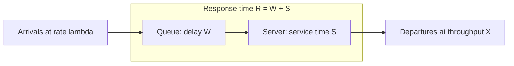

# Datacenter Systems: Queuing Theory

Queuing theory lets us predict what will happen to user performance instead of guessing. It is the tool for the "Oversubscription, Congestion, and Queuing Theory" topic in the [[Datacenter Systems/Course Introduction and Overview/Class Roadmap and Prerequisites|Class Roadmap]].

## Motivation

A queuing model helps answer questions such as:

- How will performance change if a service becomes more popular?
- How much hardware should we provision (more or less) instead of guessing?
- What happens if we change the implementation to provide more features?
- What happens if we use priorities or otherwise change the scheduling policy?
- What happens when resources run into their limits?

## The Simple Queuing Model

![[Screenshots/simple queuing model.png]]

Tasks arrive, wait in a queue, are serviced by a server, and depart. The model predicts **long-term performance in a stable system**, where the arrival rate ($\lambda$) is less than or equal to the service rate ($\mu$).

- **Stable** means the load is lower than what the system is able to process.
- The service rate is measured in terms of the server itself or its bandwidth.
- The model does **not** answer what happens when the load overloads the system (the state of the system is undefined) or give long-term relations for unstable scenarios.

### Throughput vs Bandwidth

- **Throughput**: a measurement of what came *out* of the queue (the output). It does not measure the input, and the offered load can be much higher than the bandwidth.
- **Bandwidth**: the provisioned **maximum throughput** a service or link (the "server" in queuing terms) can give us.

## Definitions

| Term | Symbol | Meaning |
| :--- | :--- | :--- |
| Queueing delay | $W$ | Wait time: the amount of time a new arrival spends in the queue before it is serviced. The number of tasks queued is $Q$. |
| Service time | $S$ | Time to service the request, from the start of service to departure. |
| Response time | $R = W + S$ | Total time in the system. Tells us what is going on inside the system. |
| Utilization | $U$ | Fraction of time the server is busy: $U = S \times \lambda$. |
| Throughput | $X$ | Rate of task completions. |

- If there is no overload, throughput equals the arrival rate. We want the two to be generally close to each other.

## Little's Law

Little's Law relates the average number of tasks in the system to the average throughput and the average response time. It is useful for averages and tells us the average time a task is inside the system.

- It applies to **any stable system**, and the **arrival distribution does not matter**.
- If you know all but one of the quantities, you can solve for the remaining one.
- You can draw the boundary around just the server, just the queue, or the whole system, depending on whether you want the average, throughput, utilization, or the number of queued tasks.
- It can help answer questions about adding hardware.
- Averages can be somewhat **deceiving**, because they abstract away what goes on inside the system.

## Arrival Patterns and Queueing

The shape of the arrival pattern determines how much queueing delay we see for the same average load.

### Best Case: Fixed, Equally Spaced Arrivals

![[Screenshots/Fixed Arrivals.png]]

- Arrival rate and service time are held constant, and each task arrives just as the previous one finishes.
- The server is always busy with **no waiting**.
- Response time stays the same for every task.
- This only happens in theory.

### Worst Case: Burst Arrival

- All requests arrive at the same time, so every task except the first is forced to wait.
- Throughput and load are the same as the best case, but **latency increases**.
- This is also theoretical, though it can happen occasionally.

![[Screenshots/Response time best vs worst case.png]]

### Average Case

What arrival process produces the typical behavior?

- **Gaussian / normal**: arrivals are spread around a mean value. The system is trying to send relatively evenly spaced requests, on a best-effort basis since unforeseen events occur.
- **Poisson / exponential**: arrivals are **memoryless** and uncoordinated.
  - Queueing is low until a point, after which the queue grows exponentially. As load approaches the service rate, the queue grows without bound.
  - Use about **20% headroom**, because that is where the queue length starts to grow exponentially.
  - It is modeled with a **Markov chain** (an automaton): $\lambda$ is the expected arrival rate, and there is a probability of a task leaving ($\mu$). Because this is probabilistic, the queue length fluctuates. If $\lambda < \mu$, the queue stays near 0; if $\lambda > \mu$, it grows toward infinity.
  - It permits a **closed-form solution** for the state probabilities as a function of the arrival rate and the service rate.

  ![[Screenshots/Exponential Distribution.png]]

- **Heavy-tailed**: arrivals are bursty, with everyone arriving at once. This is close to the worst case.

There can be randomness in both the arrivals and the service time.

### Queueing Intuition

If tasks arrive at random intervals with an average rate less than the service rate:

- Sometimes jobs arrive faster than the server can handle, and **queues build up**.
- More often jobs arrive slower than the service rate, and **queues drain**.
- Sometimes the server is idle because nothing arrives. This happens a fraction $1 - U$ of the time.

## Formal Analysis

### Formal Definition

$$
N = X \times R
$$

where $N$ is the average number of tasks in the system, $X$ is the average throughput, and $R$ is the average response time. Also:

$$
R = W + S, \qquad U = \lambda S, \qquad \text{stable} \iff \lambda \leq \mu
$$

### Simplified Explanation

The number of tasks inside the system equals how fast they leave multiplied by how long each one stays. If tasks leave 100 per second and each spends 0.5 seconds inside, about 50 are inside at any moment.

## Industry Standard Terms

| Course Term | Industry / Standard Term |
| :--- | :--- |
| Queueing delay ($W$) | Wait time / queue time |
| Service time ($S$) | Processing time / service demand |
| Response time ($R$) | Latency (end-to-end) |
| Arrival rate ($\lambda$) | Offered load / request rate |
| Throughput ($X$) | Goodput / completion rate |
| 20% headroom | Capacity headroom / target utilization |
| Poisson / exponential arrivals | M/M/1 queue |

## Related

- [[Datacenter Systems/Course Introduction and Overview/Class Roadmap and Prerequisites|Class Roadmap and Prerequisites]] — Where queuing theory fits in the class
- [[Datacenter Systems/Workloads and Software Infrastructure/Scatter-Gather Latency and Hedged Requests|Scatter-Gather Latency and Hedged Requests]] — Tail latency under fan-out
- [[Datacenter Systems/Course Introduction and Overview/Availability, Tail Latency, and PUE Formulas|Availability, Tail Latency, and PUE Formulas]]
