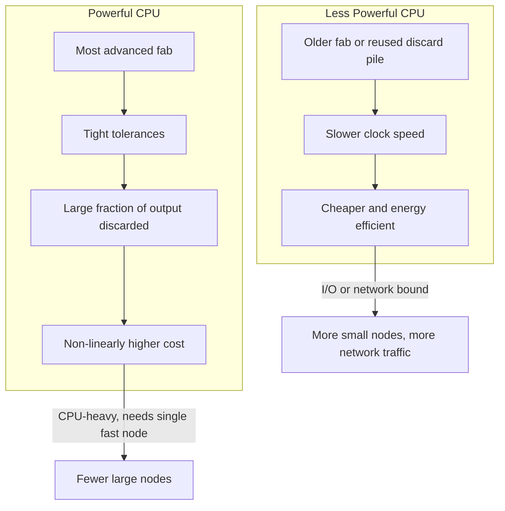

# Datacenter Systems: Right-Sizing Datacenters

**Right-sizing** is choosing the node (machine) size and application architecture that best fit a workload. The answer depends on what the workload demands, what each candidate node offers, and what each option costs. This note first lists the workload characteristics, then the node characteristics, then explains the cost reasoning that often favors many cheap nodes over fewer powerful ones. It builds on the scale-up vs scale-out model in [[Datacenter Systems/Computing Building Blocks|Computing Building Blocks]].

---

## Workload Characteristics

Before choosing hardware, characterize the workload along these axes:

- **Resource demands**
  - CPU-heavy vs I/O bound.
  - Memory capacity and bandwidth intensive.
  - Network bandwidth and latency needs.
  - Storage needs.
- **Temporal behaviors**
  - Long-running jobs vs short-running jobs.
  - Bursty vs smooth load.
  - Locality.
- **Performance requirements**
  - Low-latency, background, batch, highly available, or deadline-driven.
- **Dependencies**
  - Co-location with storage.
- **Energy and thermal**
  - Whether the workload benefits from acceleration.

---

## Node Characteristics

Each candidate node type is described by:

- Computational intensity
- Core count
- Memory capacity and bandwidth
- Network bandwidth
- Storage
- Cost
- Power consumption
- Specialized accelerators
- And more

Matching the two lists raises the questions that right-sizing must answer:

- **How do we choose the right size for the nodes?**
  - Find the trade-offs between large machines with high core counts vs lots of small machines.
  - Decide how much memory and network must be provisioned.
- **How do we architect our applications?**
  - Monolithic or distributed.
  - What are the overheads of distributing?

---

## Why Less Powerful Nodes Can Win

### More Powerful CPUs Are Non-Linearly More Expensive

- The most advanced chips need the most advanced chip fabrication facility.
- They require tighter tolerances, which means a large fraction of the manufacturing output must be discarded. The cost of the discarded chips is paid for by the chips that survive, so price grows faster than performance.

### Less Powerful CPUs Are Cheaper and More Energy Efficient

- They can be built in older fab facilities, or by reusing the discard pile (chips that failed the tolerances of the top-end part).
- They run at slower clock speeds, which also reduces power consumption.

### Networking and I/O Bound Tasks

For networking or I/O bound tasks the CPU is mostly waiting, so extra CPU speed is wasted. Less powerful and cheaper nodes are appealing even if finishing the job requires more of them, and even though distributing the work across more nodes increases network communication overhead.

---

## Improvements Today

- Moore's Law scaling of DRAM and transistor density is slowing, so density gains no longer come for free.
- Network performance is increasing and will continue to improve, which reduces the communication penalty of scaling out.
- Water cooling can make a more performant chip viable.

---

## Industry Standard Terms

| Course Term | Industry Equivalent |
| :--- | :--- |
| Right-sizing | Capacity planning / instance sizing |
| Large machine with high core count | Brawny node / scale-up |
| Lots of small machines | Wimpy node / scale-out |
| Discard pile | Binned / lower-grade silicon |
| I/O bound | Memory-bound / network-bound workload |

---

## Related

- [[Datacenter Systems/Computing Building Blocks|Computing Building Blocks]] — Scale-up vs scale-out cost model, brawny vs wimpy cores, and accelerators
- [[Datacenter Systems/Warehouse-Scale Computer Architecture|Warehouse-Scale Computer Architecture]] — Servers, networking fabric, and power and cooling
- [[Datacenter Systems/Workloads and Software Infrastructure|Workloads and Software Infrastructure]] — Workload diversity and tail latency
