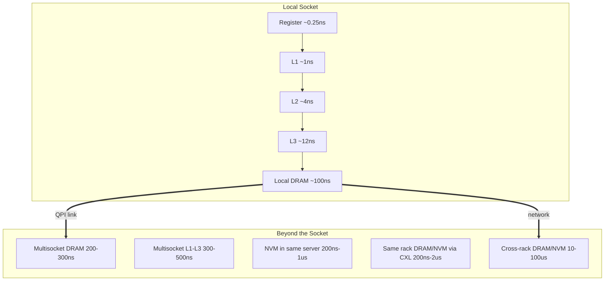

# Datacenter Systems: Server Memory Systems

A modern datacenter server is a **multisocket, multicore** machine in which memory is physically attached to specific CPU sockets. Where a piece of data lives relative to the core that needs it determines whether an access costs a fraction of a nanosecond or tens of microseconds. This note starts from the server hardware, builds up the cache and memory hierarchy, quantifies the latency of each level, and then shows how application behavior and server design choices (brawny vs wimpy) follow from those numbers.

---

## Server Hardware

![[Screenshots/Server Memory Hardware.png]]

- The **number of pins** on a chip impacts the available bandwidth. Pins are grouped into an abstraction of **lanes**, and more lanes mean more bandwidth.
- Memory is **locally connected to sockets**: each socket has its own DRAM channels.
- If we run one core on the left socket:
  - Fetching from RAM attached to its own socket is about **100ns**.
  - Fetching from RAM attached to the other socket goes over the **QPI link** and costs around **200-300ns**.
  - Non-local memory references are bottlenecked by the QPI link.

### Why Cache and DRAM Latencies Differ

- Cache is closer to the core.
- Going **off-chip** (off cycle) means going through transceivers. The signaling needs a protocol to handle failures, which adds latency.
- **DRAM** is a simpler technology than cache because it needs fewer transistors per bit. An access must pre-charge a row and then access the column. The hardware is cheaper to build, but the memory protocol run by the memory controller is more complex, and that complexity introduces latency.

### QPI Links

- The **QuickPath Interconnect (QPI)** protocol is optimized for small, low-latency accesses. By contrast, PCIe is designed for large bulk transfers, and DDR is optimized for cache-line accesses. See [[Datacenter Systems/IO Virtualization/Physical IO Foundations|Physical IO Foundations]].
- It provides **cache coherence** across sockets.
- Hardware must provide legacy support so that software keeps the illusion it is running on the same single machine. Of course, bandwidth and latency will change depending on where the data is.
- Modern OSes and hypervisors are aware of this: they prefer **local memory**, and only go non-local once the working set outgrows local memory or reads begin to touch non-local memory.

### Why Two-Socket Servers Are Brawny

The common architecture for 2-socket servers uses **brawny** cores. Two laws explain why:

- **Moore's Law**: CPUs are optimized for the sequential use case, accelerating sequential code and parallelizing under the hood with out-of-order execution and branch prediction.
- **Amdahl's Law**: it is easier to write sequential code, and parallelization is post-hoc work. See [[Data Structures and Parallelism/Parallelism/Amdahl's Law|Amdahl's Law]].
- All non-local references have been optimized for bandwidth over latency.
- The number of applications that can make use of more than what we already have is small, and the cost does not justify it (or those applications must pay a premium).

---

## Multisocket Multicore

![[Screenshots/System with multiple multicore chips.png]]

- **L1 and L2 are private to each core.**
- **L3 is shared among the cores** of a chip.

### Why So Many Layers

- **Smaller is faster**, because the amount of data that must be addressed is smaller.
  - SRAM is essentially an associative array: it is read and gives back the value. With DRAM, the memory controller tells you it found the location and then you still have to dereference it.
  - A lookup in a bigger level has to traverse a more complex structure of SRAM.
  - L3 has more logic because of cache coherency, and each piece of logic adds latency.
  - Analogy: looking for a book on a bookshelf is faster than looking for it in a library.
- **Smaller distance reduces latency.**

---

## NUMA: Non-Uniform Memory Access

In a multisocket server, the time to reach memory is non-uniform: it depends on which level and which socket holds the data.

### ALU and SRAM

- **Register**: about 0.25ns (1 cycle at 4GHz, standard in datacenters). The ALU performs direct arithmetic operations on registers.
- **SRAM**
  - **L1**: 1ns, sized in kilobytes.
  - **L2**: 4ns, 1MB/core, **inclusive**. Inclusive caching means the lower levels can hold the same data, which is easier to implement.
  - **L3**: 12ns, 1MB/core (newer technology is almost a GB per core), shared, **non-inclusive**.

### DRAM and Beyond

- **Local DRAM**: about 100ns. It is a different technology and physically further from the core.
- **Multisocket DRAM**: 200-300ns, because the access needs to go through QPI.
- **Multisocket L1-L3**: about 300-500ns. This is more expensive than reading remote DRAM because of cache coherency, whereas DRAM is not cached and so can be faster.
- **Non-volatile memory (NVM) in the same server**: 200ns-1us.
- **Same-rack DRAM/NVM (CXL)**: 200ns-2us.
  - **Compute Express Link (CXL)** is a newer technology.
  - It is a protocol extension to PCIe that is better suited for low-latency cache-line access.
  - It allows the CPU to directly load and store values in the PCIe device.
  - It enables memory expansion: memory placed in the expansion device can be accessed by the CPU, though the access still goes through PCIe.
  - **Disaggregated memory** (reached through a network switch) adds multiple microseconds.
- **Cross-rack DRAM/NVM**: 10-100us.
  - The speed of light impacts the time less than the network switches do.
  - The number of hops impacts the time more than the propagation of light on the wire.

---

## Application Memory Use

- We write applications sequentially, so caches are optimized for this.
- Many cloud applications have **spatial and temporal locality**.
  - The cache memory hierarchy is effective at hiding DRAM latency.
  - Branch logic makes caches effective.
- For other applications (graph analysis, memory streaming):
  - Performance is dominated by **cache miss behavior**.
  - NUMA effects and remote memory latency matter.
- GPUs/TPUs provide a greater density of ALUs relative to CPUs.
  - It is less costly if an ALU has to wait for memory on a GPU than on a CPU, because there are many other ALUs still doing work.

---

## Using Wimpy Servers

![[Screenshots/Application Performance as communication increases.png]]

- A research project took **wimpy servers** to their logical conclusion, using Amdahl's Law as the guide.
  - Code will eventually branch.
  - The speedup will be limited by sequential and branching code, but we will always have sequential code in our program.
- The energy per compute of a wimpy server is much lower than that of a high-end out-of-order CPU.
- Limitations of wimpy servers:
  - **Amdahl's Law**: speedup is limited by the speed of sequential code.
  - Speedup is limited by the worst-case communication latency, which gets worse with a larger number of servers.
  - It is harder to bin-pack work into wimpy servers.

---

## Related

- [[Datacenter Systems/Computing Building Blocks|Computing Building Blocks]]: scale-up vs scale-out and brawny vs wimpy cores
- [[Datacenter Systems/Right-Sizing Datacenters|Right-Sizing Datacenters]]
- [[Datacenter Systems/IO Virtualization/Physical IO Foundations|Physical IO Foundations]]: PCIe, QPI, and CXL interconnects
- [[Datacenter Systems/Warehouse-Scale Computer Architecture/Hardware Building Blocks|Hardware Building Blocks]]
- [[Data Structures and Parallelism/Parallelism/Amdahl's Law|Amdahl's Law]]

## Industry Standard Terms

- **Non-local / multisocket memory access** → NUMA remote access
- **QPI** → Intel UPI, AMD Infinity Fabric (inter-socket coherent interconnect)
- **Brawny cores** → high-performance out-of-order cores
- **Wimpy servers** → low-power throughput servers (e.g., ARM-based)
- **Disaggregated memory** → memory pooling over CXL or the network
