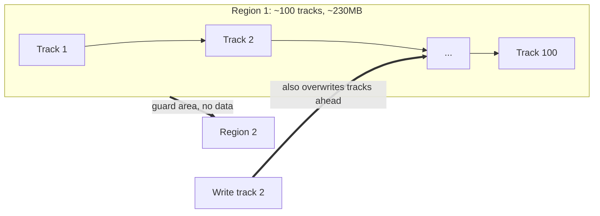

# Datacenter Systems: HDDs

This note continues [[Datacenter Systems/Server Memory Systems/SSD|SSD]] and the tiering discussion in [[Datacenter Systems/Server Memory Systems/Server Memory Technologies|Server Memory Technologies]]. It covers the state of the art in hard disk density, why disk latency makes random I/O so poor, where disks sit in the datacenter (the coldest ~90% of data, justified by the **Zipf distribution**), and the two techniques used to push density further: **shingle disks** and **HAMR/MAMR**. For the single-disk baseline, see [[Operating Systems/Persistence/Storage/Secondary Storage/HDD|HDD]].

---

## Storage Density State of the Art

The running example is the **Toshiba MAMR 18TB 3.5" HDD**.

- **Storage per disk**:
  - Number of platters: 9 platters of 2TB each.
  - **Areal storage density**: ~1.5Tb per square inch.
  - **Disk track width** is ~400nm, about the wavelength of light.
  - The read/writeable surface area is limited by the 3.5" form factor; Toshiba's MAMR disk uses ~80% of the platter area.
- **Areal density** improves slowly, slower than Moore's law. The techniques used:
  - **Perpendicular recording**.
  - **Helium filled** enclosures, which give more precise aerodynamics for positioning the disk head.
  - [[#Shingle Disks|Shingle disks]].
  - [[#Heat and Microwave Assisted Magnetic Recording|HAMR/MAMR]]: Heat/Microwave Assisted Magnetic Recording.
- The number of platters can also be increased, but this increases the physical volume. More capacity makes the drive taller, but nothing stops us from adding platters.
- **Power**: an HDD generally draws 5-8W while operating. Flash devices behave differently: a flash device draws ~0 if you do not use it, but upwards of 25-30W when used at capacity.

---

## Disk Performance

Disk latency is the sum of three components:

$$\text{Disk Latency} = \text{seek time} + \text{rotation time} + \text{transfer time}$$

- **Seek time**: time to move the disk arm over the correct track (5-10ms).
  - Fine-grained position adjustment is also needed for the head to "settle" (~1ms).
  - This step finds the right track.
- **Rotation time**: time to wait for the disk to rotate until the target sector is under the disk head.
  - A 7200 rpm disk takes 8.5ms per rotation; the outer rim travels at ~75mph.
- **Transfer time**: time to read or write the data once the head is in position.
  - **Disk head transfer rate**: 281MB/s (~14 usec per 4KB disk block).
  - **Host transfer rate** depends on the I/O connector (typically 750MB/s).
- The **disk buffer cache** runs at 512MB/s and is often battery backed (persistent). It hides disk rotation for large transfers.

Seek and rotation are mechanical, so in terms of latency, **random I/O performance is very bad**.

### Performance Implications

- Very limited number of operations per second: **100-150**, since each one pays a disk seek plus rotation. It takes milliseconds to reposition the head.
- Once the head is in position, data transfers at a high rate: up to **70,000 disk blocks per second** is the upper limit for sequential reading or writing after repositioning.

The gap between these two numbers (~100 random operations versus ~70,000 sequential blocks per second) is why the rest of this note is about keeping HDDs on sequential, cold workloads.

---

## How Disks Are Used in the Datacenter

- HDDs store the **least frequently used ~90% of data**.
- That data is, once written, almost never read or modified.
- The capacity ratios between tiers are determined by the **cache miss ratio** of each tier, which is what the Zipf distribution below quantifies.

### How Many Cache Misses Reach the Last 90%?

- The caching behavior of many systems is not well characterized by the working set model.
- An alternative is the **Zipf distribution**:
  - Popularity $\sim 1/k^c$ for the $k$th most popular item, with $1 < c < 2$.
  - It is based on how often words appear in the English language: the $n$th most popular word appears with frequency $1/n^c$.
  - The most popular item is accessed a certain amount, and the following items fall off according to this distribution.

#### Zipf Distribution

The area under the Zipf curve is **cumulative popularity**. On a log-scale rank axis, each decade of ranks contributes equal area:

- Items 100-1,000
- are the same as items 1,000-10,000
- which are the same as items 10,000-100,000
- which are the same as items 100,000-1,000,000, and so on.

Equal area means equal popularity: the thousands of items between rank 100 and 1,000 together receive as many accesses as the hundreds of thousands between 100,000 and 1,000,000.

![[Screenshots/Zipf Distribution.png]]

#### Zipf and Caching

Because each decade of items is worth the same fraction of accesses, the cache miss rate falls roughly linearly as the cache size grows on a log scale. This maps cleanly onto the storage hierarchy:

- **DRAM**: almost all reads; it holds the hottest items, so the miss rate is highest above it.
- **NVM**: mostly reads.
- **SSD storage as a cache**: balanced read/write. Near NVM it uses SLC; near HDD it uses QLC.
- **HDD storage**: has the most storage but sees few cache misses, and its traffic is mostly writes.
- A cache is only effective if it covers about 90% of hot accesses.

![[Screenshots/Zipf and Caching.png]]

---

## Shingle Disks

- Disks were originally designed so that each track could be written independently.
  - Writing a track can still affect data stored in nearby tracks.
  - To avoid this, disks use per-sector ECC and a limit on track density.
- **Shingle disks** drop that limit to gain density:
  - Writing a track **overwrites both the current track and neighboring track(s)**.
  - This happens in **one direction only**, because of the shape of the magnetic head.
  - A **guard** (extra space with no data) is inserted between every $k$th track.
- Instead of magnetizing each track in isolation, shingles overlay each other like roof shingles. The magnet overwrites the track we want and also several tracks forward from it, parts of the disk we do not actually want to overwrite. Nothing outward of the written track matters, so that side does not need to be protected.

### How to Use a Shingle Disk

- Group ~100 tracks into a **region**, separated by guard areas.
- Each region can be safely **written sequentially**.
  - There is **no update in-place** without rewriting the entire region.
  - Reads are also treated sequentially.
- A shingle is typically ~230MB (it varies with track circumference).
- The disk can be subdivided into regions and exposed to the OS as a **zoned** device, with the same interface as zoned SSDs (see [[Datacenter Systems/Server Memory Systems/SSD|SSD]]).

### Dropbox Use of Shingle Disks

- Actively used or modified data is kept on SSDs.
- Only **cold data** is stored on HDDs.
  - Large files are stored as a small number of shingle blocks.
  - Small files are aggregated into shingle blocks.
- Hotter, random accesses are absorbed by the SSDs because they are faster; reads that reach the HDDs are for cold data.

---

## Heat and Microwave Assisted Magnetic Recording

The limit on bit density is the **magnetic changeability** of the material. Two requirements pull in opposite directions:

- It must be **high**, because the disk head is over a bit for less than 1ns.
- It must be **low**, to resist bit flips caused by writes to nearby tracks.

**HAMR** (heat assisted) resolves this because the material becomes more changeable at high temperature:

- Before writing, a tiny **laser** heats the bit up.
- The bit cools down before the next bit is written.
- Only the heated bit is easily magnetized; the unheated medium around it is less excitable by the magnet. Magnetization is what matters, and it takes a long time to reduce.

**MAMR** (microwave assisted) uses **microwaves** instead of a laser to energize the bits. In both cases the aim is higher density while also improving the speed of I/O to the platters.

---

## Related

- [[Datacenter Systems/Server Memory Systems/SSD|SSD]]: the tier above HDDs; zoned namespaces mirror shingle regions
- [[Datacenter Systems/Server Memory Systems/Server Memory Technologies|Server Memory Technologies]]: the DRAM, NVM, and flash hierarchy
- [[Datacenter Systems/Quantitative Availability|Quantitative Availability]]: replication and erasure coding for the data on these disks
- [[Operating Systems/Persistence/Storage/Secondary Storage/HDD|HDD]]: disk basics

## Industry Standard Terms

- **Shingle disk** → shingled magnetic recording (SMR)
- **Shingle region** → SMR zone (host-managed zoned block device)
- **Guard area** → guard band
- **Areal density** → bits per square inch
- **HAMR / MAMR** → heat-assisted / microwave-assisted magnetic recording
- **Disk buffer cache** → on-drive write cache (DRAM)
- **Zipf distribution** → power-law popularity distribution
