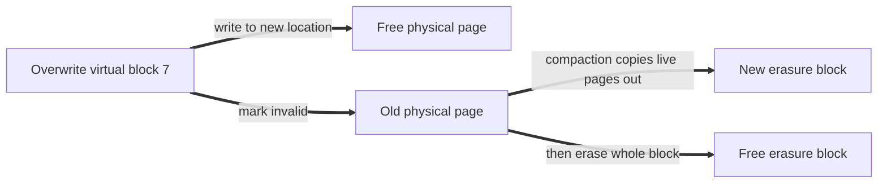

# Datacenter Systems: SSD

This note continues [[Datacenter Systems/Server Memory Systems/Server Memory Technologies|Server Memory Technologies]], where SSDs appeared as miniaturized EEPROMs that are too slow to be main memory. It explains how the read-erase-write nature of flash forces a **Flash Translation Layer (FTL)**, why that layer causes compaction overhead and tail latency, and how **zoned namespaces** move the problem to the OS. For the device-level view, see [[Operating Systems/Persistence/Storage/Flash Storage|Flash Storage]].

---

## Basics

At a physical level, an SSD is **read-erase-write** storage:

- **Reads** can be of individual disk blocks (4KB) or larger.
- **Writes** go only to empty (erased) disk blocks (4KB) or larger.
- Data is **erased** in **erasure blocks** (~1-8MB), also called **chunks**.
  - Erase is much slower than read or write, so it is typically done in the background.
  - Erasure blocks **wear out**: a chunk stops working after roughly 10-35K erasures.
- When the disk fills up, we need to **compact** live data so that erasures can happen.

---

## Physical Layer Evolution

SSDs have different internal bit-level encodings:

| Cell type | Bits per cell | Notes |
| :--- | :--- | :--- |
| SLC (single level cell) | 1 | |
| MLC or DLC (multilevel cell) | 2 | Needs error correcting codes |
| TLC (triple level cell) | 3 | |
| QLC (quad level cell) | 4 | 8TB QLC SSD (2020) |

- Cells are also stacked in **3D**.
- **Sparser encoding** suits frequently changed data (e.g. a block cache):
  - Higher cost, faster writes, and more erasure cycles before wearing out.
  - Competes with NVM.
- **Denser encoding** suits cold data:
  - Competes with hard disks.

### Error Correction

- **ECC** gives data resilience, with an uncorrected bit error rate of about $1/10^{17}$.
- In a cloud setting, an application-level validation check is still needed.
- Roughly every petabyte goes over this error rate, but each storage layer added on top has its own error correcting code, so it is fine.

---

## SSD vs HDD (2026)

SSD is superior in every metric besides cost.

![[Screenshots/SSD vs HHD (2026).png]]

---

## Flash Translation Layer (FTL)

The **FTL** is the layer that gives the illusion of a simple block device on top of read-erase-write flash.

- SSD firmware exports a **virtual block interface**: read, write, and **trim** (delete).
  - Trim is faster than an HDD delete: it just marks the block as deleted, so you cannot read or write it until the cleanup is done in the background.
- The firmware **relocates** each virtual block to a physical location as needed.
  - An overwrite to a previously written virtual block goes to a **new location**, leaving dead space in the previous one. The old block is marked "invalid".
- **FTL compaction**: live blocks are rewritten from partly dead erasure blocks into a new block, which frees whole erasure blocks so they can be erased.

### The Mapping Table

- The FTL is a **map from virtual block number to physical location**.
- It is cached in **SRAM** for fast lookup, and stored persistently on the SSD.
- It is effectively the page table the FTL maintains. It must survive power loss, so the SSD keeps some charge available to write the data in SRAM into its flash for recovery.

---

## FTL Overhead vs SSD Utilization

- As disk utilization gets higher, the worst-case compaction overhead gets heavier.
- We can avoid this by **reserving unused physical space** on the SSD (~20-30%).
- Compaction typically moves data to another block on the same **lane**.

### Lanes and Striping

- We can write to lanes **in parallel**.
- Writes are **striped** round-robin across lanes, which gives larger capacity and bandwidth out of the SSD.
- Implications of striping:
  - Blocks written together are spread over many erasure blocks.
  - Even when writing entire chunks, we still pay compaction overhead; we would need a giant chunk to avoid it.
  - Compaction can slow down reads of data in the same lane.

![[Screenshots/SSD physical Layout.png]]

---

## Performance of Random Writes to SSD

- The higher the utilization, the lower the throughput.
- The larger the write size, the better the throughput holds up as utilization increases.
- So write as large as possible to flash (buffering writes helps).

![[Screenshots/performance of random writes on SSD.png]]

---

## FTL Sharing

- When an SSD is shared, random behavior by one application can trigger compaction overhead for all of them.
- Compaction overhead is caused when: (this line is incomplete in the original notes)

---

## Problems with Device-Level FTL

- **Variable read/write tail latency** due to compaction.
  - The device needs to support temporarily pausing compaction for real-time operations.
- **Storage space overhead of 20-30%**, to store the page table that the FTL uses and to hold spare blocks in case blocks wear out.
- **Write amplification** can be high even with large block sizes.
  - A study shows a 6x loss in throughput with 8MB random writes.
  - Presumably even bigger with smaller operations.
- The device can **mix blocks from different applications** into one erasure block, which is a performance isolation problem.

These can potentially be fixed with zoned namespaces.

---

## SSDs with Zoned Namespaces

A **zone** is an allocation region of the SSD:

- It is a complete erasure block.
- The access pattern is: **write sequentially, read randomly, erase**.
- There is **no need for a spare region** for the FTL, so the OS can use the entire SSD.
- The zone ID is virtual: the device maintains a mapping from virtual zone ID to physical location.
- Zones can be assigned to a guest OS or to applications.
  - No more performance cross-talk.
  - Saves the 20-30% of space, but the OS needs to manage a table.
- The hypervisor can better manage performance, since each VM manages its own resources.

### OS with Zoned SSDs

The OS runs a **log-structured storage system**:

- The OS must implement the FTL itself, with the map stored on the SSD.
- Each zone block write invalidates previously written blocks.
- The OS compacts to create space for new entries.

In return, the OS can:

- Prioritize tail latency over compaction.
- Separate different uses into different zones.
- Separate hot and cold data into different zones.
- Use the entire device (if read-only).

---

## Combine File System and FTL

Combining them can provide better performance (a similar domain to virtualization).

**File system translation:**

- File name to inode number.
- Inode number + offset to disk block address.
  - Extent based: block ranges give more efficient lookup for contiguous blocks.
  - Huge pages.

**FTL translation:** virtual disk block to physical block address.

With zones, do we need all three translations?

- Write a 1GB file so that it coalesces into a small number of zones.
- If we need to compact the SSD zone, we update the inode (and there is no FTL).

---

## And Beyond

- Applications can build their own **application-layer** translation, for example a **key-value store**.
  - The application must build a data structure for better performance, which also needs its own file write performance and compaction.

---

## Related

- [[Datacenter Systems/Server Memory Systems/Server Memory Technologies|Server Memory Technologies]]: where SSDs sit between DRAM and disk
- [[Operating Systems/Persistence/Storage/Flash Storage|Flash Storage]]: flash internals
- [[Operating Systems/Persistence/Storage/Defragmentation and TRIM operations|Defragmentation and TRIM operations]]: trim and background cleanup
- [[Operating Systems/Persistence/Storage/Secondary Storage/HDD|HDD]]: the disk baseline

## Industry Standard Terms

- **FTL** → flash translation layer (SSD controller firmware)
- **Compaction** → garbage collection
- **Reserved unused space (~20-30%)** → over-provisioning
- **Write amplification** → write amplification factor (WAF)
- **Zoned namespaces** → NVMe ZNS
- **Trim** → TRIM / discard
- **Lane** → flash channel
