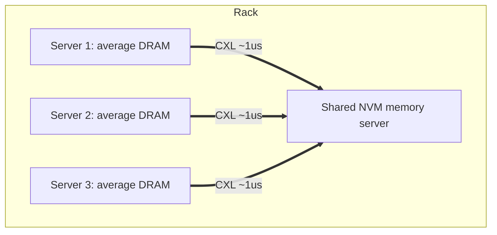

# Datacenter Systems: Server Memory Technologies

This note continues [[Datacenter Systems/Server Memory Systems/Server Memory Systems|Server Memory Systems]]. It starts from how a server boots (non-volatile memory), then covers the two volatile technologies used for working memory (SRAM and DRAM), and then asks what to do for memory-intensive applications when SRAM is too small, DRAM is too power-hungry, and SSDs are too slow. The answer is **phase-change memory (PCM)**, which can be deployed as tiered memory, hybrid memory, rack-level disaggregated memory, a low-latency SSD replacement, or a persistent write buffer.

---

## Non-Volatile Memory (NVM)

A machine must execute instructions to fetch the OS from disk or over the network (a **bootloader**, which then executes the OS). Those first instructions must survive power loss, so they live in non-volatile memory.

- There are several **levels of bootloaders** before the OS is loaded.
- Booting over the network exists for legacy reasons, and in datacenters it makes the boot image centralized and easier to maintain.
- Bootloaders have become sophisticated, almost like small OSes themselves (e.g. they need device drivers so they can load the OS from the network).

### Evolution of Programmable Read-Only Memory

| Technology | Full name | How it is written/erased | Notes |
| :--- | :--- | :--- | :--- |
| PROM | Programmable read-only memory | One time programmable | Mass produced as a blank slate, where the bootloader instructions are put. Not used in datacenters anymore. |
| EPROM | Erasable PROM | Erased by shining UV light | Lets us change the bootloader, but requires UV light to erase it. |
| EEPROM | Electrically erasable PROM | Erased with a high-voltage charge | More convenient than EPROM since no light is needed. Only a limited number of erases before it is destroyed. |

- In EEPROM we are overloading the circuit so that it resets and becomes programmable again. This is the foundation of **flash memory**: we reset it by "flashing" it.
- **SSDs are miniaturized EEPROMs**: cheap, but expensive to erase, with a limited number of erase cycles (millions).

---

## SRAM and DRAM

### SRAM

**SRAM (static RAM)** is used in caches.

- It uses a **flip-flop per bit**, the same technology as CPU registers.
- It is built like a logic circuit, which makes it fast and adaptable but also **bulky**.
- It behaves like an **associative** type of memory: the hardware routes the charge to the correct cell and returns the value. This becomes more complex as the SRAM becomes larger, which is the reason for having **levels** of SRAM.
- Latency is proportional to the size of the SRAM and its distance to the CPU.
  - Size impacts distance, and distance matters because charge moves at (at most) the speed of light.
  - It gets worse as the structure gets more complex, since access speed is limited by the travelling charge.

### DRAM

**DRAM (dynamic RAM)** is much denser than SRAM and is on the same Moore's Law curve.

- A bit is stored more like a **capacitor**: it holds a charge for a while but **leaks**.
- A **refresh cycle** is needed to maintain data (unlike SRAM): about every **~50ms**, every memory value is read and rewritten to recharge the DRAM so it does not lose data.
  - Refresh was software-based before, but is hardware-based now.
  - This constant recharging is also why it is called "dynamic" RAM.

### Rowhammer: DRAM Leakage as an Attack

DRAM leakage is a problem exploited by the **rowhammer attack**:

- Write to the bits in the DRAM words **next to** the target, much faster than the refresh rate.
- The charge leakage spills into the target cell and **flips its bits**, so we incur a write to a memory cell that we may not have intended to write.

To mount it, the attacker has to:

1. Figure out which DRAM cells are being written to, and stride memory accesses so they are performed in parallel.
2. Figure out the virtual-to-physical mapping and the memory layout.
3. Once the mapping is known, hammer the memory locations that map to the cells adjacent to the target (the target is "sandwiched" between two cells being written).

### Battery-Backed DRAM

- DRAM can also be used as **limited-time NVM** by adding a battery, and it can hold charge for days.
- It is not always safe: the battery may be bad or out for a long time, so fault tolerance is limited.

---

## Phase Change Memory (PCM)

For memory-intensive applications, the options are:

| Option | Problem |
| :--- | :--- |
| SRAM | Transistor density limits each chip to ~40-50MB |
| DRAM | Power draw goes up with capacity |
| SSD | Latency is at least 100x slower than DRAM (1,000-10,000x in the past); throughput is 40-50x slower than DRAM; block oriented rather than random access; limited number of write cycles |

- SSDs are only readable in **4KB blocks**, and cannot be mapped directly into the processor's cache since one page is 4KB. Fine-grain access is therefore expensive.
- **Phase-change memory** lets us be more coarse-grained in the other direction: it is similar to erasable CDs and DVDs.
  - It reads and writes at **cache-block size** (vs. SSD blocks of 4KB).
  - It is non-volatile, and it also wears out, but much more slowly than an SSD.
  - It is much cheaper than SSD, per the lecture notes.

### PCM Characteristics

![[Screenshots/DRAM vs Optane (PCM) vs SSD.png]]

- PCM is cheap to **write** compared to DRAM because we write into a write buffer before the data goes to the PCM (NVM local to the buffer).
- **Reading** takes longer, since a read is closer to the true latency of the PCM.

### PCM Use Cases

- **Tiered memory**: programs run in DRAM and page in/out to NVM. Suits programs that exhibit spatial/temporal locality.
- **Hybrid memory**: servers with very large (many-TB) memories. Suits programs without locality, such as machine learning and graph algorithms. More memory is available and so is more bandwidth, which lets us use memory in parallel.
- **Disaggregated NVM at the rack level (CXL)**: avoids resource stranding and reduces energy use.
  - Going over CXL means using a memory-like technology, but PCM is already in a slower domain, so we can accept the slower interconnect and use it as an SSD replacement.
- **Low-latency SSD replacement.**
- **Persistent distributed write buffer** (Assise): use the high speed of PCM as a persistent, distributed write buffer.

---

## Tiered Memory

The cost of a miss depends on which backing store sits behind DRAM:

| Level | Latency |
| :--- | :--- |
| Last-level on-chip cache | 12ns |
| DRAM | 80ns |
| Hardware-managed NVM as backing store | 300ns per miss |
| OS-managed NVM as backing store | 1us per page fault |
| Local SSD as backing store | 10us per page fault |

To keep the app slowdown (due to the backing store) to **10%**:

- Hardware-managed NVM: **10 instructions** per memory word fetched from NVM.
- SSD: **3K instructions** per memory word fetched from the SSD.

Design notes:

- We can map cache lines to phase-change memory (this causes repetition due to the mapping).
- More complex protocols make the tier slower and harder to implement in hardware.
- Once we have a tiered system, we need logic to decide which tier the data goes into. For memory, we care about low latency, so the tiering can be implemented in **hardware**.

---

## Hybrid Memory

- Configure servers with **both DRAM and NVM**.
- Use **page tables** to map directly into the application address space:
  - Application-aware use of NVM (or the OS assigns DRAM/NVM to match use).
  - Put the stack and local heap in DRAM, and large data in NVM.
  - Use **huge pages** to reduce TLB misses.

---

## Rack-Level Disaggregated NVM

**CXL (Compute Express Link)** is PCIe plus cache coherence at rack level, with latency around 1us. See [[Datacenter Systems/IO Virtualization/Physical IO Foundations|Physical IO Foundations]].

The goal is to **reduce stranded DRAM**:

- Today, each server must be configured with the maximum DRAM it might need.
- If it runs short, paging to SSD is painful.
- Putting NVM on each server is expensive.

Instead:

- Configure each server for its average DRAM need (or less).
- Put that money into a shared, per-rack NVM memory server.
- Map or page over CXL.

Example: reduce DRAM by 100GB per server and add 100TB of cache-coherent CXL NVM.

- Slightly slower when apps max out DRAM.
- Much faster for apps that use a huge amount of memory.
- Much cheaper and lower energy use than DRAM.

---

## Low Latency SSD

- **Today**: disaggregated block or file storage.
  - Network access to a replicated SSD for warm data.
  - Spill to Reed-Solomon compressed disk storage for cold data.
- **Future**: NVM as an intermediate block storage layer.
  - 10x lower (the rest of this line is incomplete in the original notes).

---

## NVM Use Case: Persistent Write Buffer

- Requires a correct sequence of `fsync` calls (for files and directories).
- Low-latency, word-addressable stable storage can change how we write programs:
  - Persist every change to a data structure.
  - Persist every client request (transaction storage).

---

## Related

- [[Datacenter Systems/Server Memory Systems/Server Memory Systems|Server Memory Systems]]: NUMA, the latency hierarchy, and CXL
- [[Datacenter Systems/IO Virtualization/Physical IO Foundations|Physical IO Foundations]]: PCIe, QPI, and CXL
- [[Datacenter Systems/Course Introduction and Overview/Failure Modes|Failure Modes]]: resource stranding

## Industry Standard Terms

- **Hardware-managed NVM as backing store** → memory-mode (transparent) persistent memory, e.g. Intel Optane DC in Memory Mode
- **Hybrid memory** → App Direct mode persistent memory
- **Rack-level disaggregated NVM** → CXL memory pooling / memory expander
- **Reduce stranded DRAM** → memory disaggregation to improve utilization
- **Persistent distributed write buffer** → persistent-memory write-ahead log / journal
