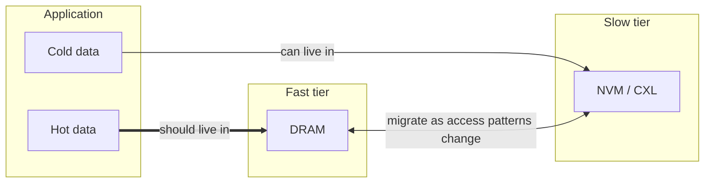
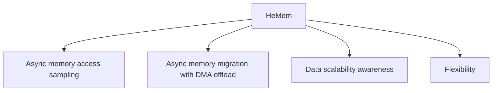
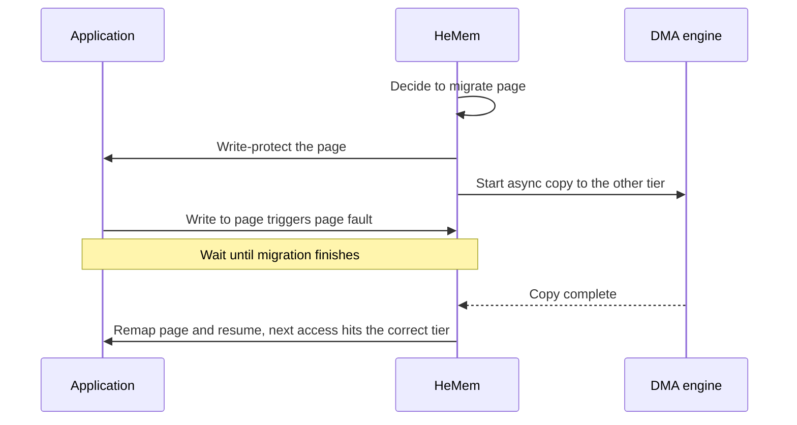

# Datacenter Systems: Tiered Memory Management

This note continues [[Datacenter Systems/Server Memory Systems/Server Memory Technologies|Server Memory Technologies]], where tiered memory was introduced as one way to deploy a slower, denser memory next to DRAM. It first explains why big data applications keep demanding more memory and why simply buying DRAM is too expensive, then shows how a slow tier (NVM or CXL) changes the picture. It then lists the three challenges of managing two tiers, explains why existing approaches fall short, and finishes with **HeMem**, a system designed around those challenges.

## Memory Needs of Big Data Applications

- There is always a demand for more memory, and applications continuously demand more of it (key-value stores, databases, graph processing, machine learning, etc.).
- These applications need **high bandwidth** and **low latency** access to their data, so the data cannot simply be pushed out to a slow device such as an [[Datacenter Systems/Server Memory Systems/SSD|SSD]].

### Why Not Just Add DRAM

Increasing DRAM capacity to serve application needs is expensive:

- Microsoft reports DRAM makes up **50% of Azure server cost**.
- Meta reports DRAM makes up **40% of rack costs**.

## New Byte-Addressable Memories

Two newer technologies are **byte-addressable** like DRAM (the CPU can load and store them directly, unlike an SSD) but cheaper per byte and denser:

- **Non-volatile memory (NVM)**
- **Compute eXpress Link (CXL)** attached memory

![[Screenshots/DRAM vs NVM vs CXL.png]]

### Tiered Memory

The idea is to stop treating all memory as one pool:

- Use **DRAM** as the **fast memory tier**.
- Make **NVM/CXL** a new **slow memory tier**.
- Goal: a **large amount of main memory with high performance**.

![[Screenshots/Tiered main memory.png]]

The catch is that the two tiers have different performance, so something has to decide which data lives where. That is the **tiered memory management** problem.

## Challenges of Tiered Memory Management

| Challenge | Why it is hard |
| :--- | :--- |
| Maximize performance | The tiers have non-uniform performance, so a bad placement slows the application |
| Scale to terabytes | Tracking must stay cheap as capacity keeps growing |
| Balance utilization and performance | Colocated applications must share scarce fast memory without stranding resources |

### Maximize Performance on Tiered Memory

- Tiered memory has **non-uniform memory performance**, and this can hurt application performance if it is not managed carefully.
- To avoid slowdown, **hot** application data should be in the fast tier. **Cold** application data can be in the slow tier.
- Access patterns are **not known ahead of time** and **change over time**, so the policy that picks what to evict from the fast tier must be kept up to date.
- How do we decide what is hot or cold? LRU, frequency, or something else? Each has pros and cons.

![[Screenshots/fast vs slow memory.png]]

### Scale to Terabytes of Memory

- Memory capacity keeps growing. We are already at TBs and can scale further.
- Mechanisms therefore need to be **lightweight**.
- In the past, **page table scans** were used to manage memory: the OS checks the accessed/dirty bits in each page table entry (see [[Hardware & Software Interface/Memory Management/Page Tables|Page Tables]]). Can this scale to GBs or TBs of memory?
  - With base (small) pages it does not scale well. With giga (huge) pages it does, because there are far fewer entries to scan.
  - Scanning a large memory with base pages takes **seconds**.
  - Clearing the bits also incurs the overhead of **[[Hardware & Software Interface/Memory Management/Translation Lookaside Buffer (TLB 351)|TLB]] shootdowns**, since cached translations must be invalidated for the cleared bits to be set again on the next access.

### Balance Utilization and Performance

- Applications are often **colocated** on datacenter systems and have different performance requirements:
  - **Latency sensitive (LS)**: low response latency requirements.
  - **Best effort (BE)**: no hard performance requirements.
- Operators want to **maximize machine utilization**, but scarce fast memory capacity must be shared. The goal is to meet each application's performance requirements without **stranding** resources.

## Existing Tiered Memory Management

| Approach | Problem |
| :--- | :--- |
| Swapping (SSD, compressed DRAM) | High overhead for byte-addressable slow memory, which could be accessed directly |
| AutoNUMA / AutoTiering | High page table scanning and page fault overhead to determine memory access behavior |
| Other systems | Do not consider colocation or big data applications |

## HeMem

**HeMem** is a scalable software tiered memory management system designed for big data applications on isolated system partitions.

### Design Principles

- **Async memory access sampling** with CPU performance counters.
- **Async memory migration** (with DMA offload). To manage the memory system efficiently, work must be asynchronous so it can run in the background.
- **Data scalability awareness**. Tracking everything does not scale, so HeMem treats different kinds of memory differently (see below).
- **Flexibility**. Datacenters want to be nimble and tweak policies at **user level**. Doing it in the kernel is risky because breaking the kernel requires a reboot.

### Async Memory Access Sampling

HeMem needs to know how often each page is accessed without scanning page tables. It uses **PEBS (Processor Event-Based Sampling)**:

- Supported in modern Intel processors, and able to accurately tell memory access frequency.
- The processor records samples of **load/store virtual memory addresses**. The records are **asynchronously** stored in a memory buffer.
- HeMem reads the buffer every once in a while to tally reads and writes per page. From the tallies it maintains **two linked lists (hot and cold)** for each memory tier.
- It measures fast and slow memory **loads** and all **stores**, instead of using page table access/dirty bits.
- Sampling **0.02%** of all memory accesses provides sufficient fidelity (found with a sensitivity study on memory-intensive applications).

### Async Memory Migration

Once a page is classified, HeMem moves hot data into the fast tier and cold data into the slow tier, with the copy **offloaded to DMA** (see [[Datacenter Systems/IO Virtualization/DMA Ring Buffers|DMA Ring Buffers]]) so it runs in the background.

- The data being moved must still be **up to date** when it lands, so the page is **write-protected** while a migration decision is carried out, even with the DMA offload running in the background.
- If the application touches the page while it is moving, it takes a **page fault**. This guarantees the next access goes to the correct memory tier.

![[Screenshots/Async memory migration with DMA.png]]

### Data Scalability Awareness

Tracking hot and cold memory is expensive with lots of memory, so HeMem only manages what is worth tracking:

- Only manage objects that are **long-lived and likely to grow**. Let Linux handle everything else (program text, kernel objects).
- **Code** stays the same size, and the **stack** does not grow as fast. These are frequently accessed, so they can stay in fast memory.
- Smaller objects are more likely to be short-lived and can also stay in fast memory.
- The **heap** will grow, so HeMem monitors how large it is and, if it is big, tracks it in a tree/heap structure (B-tree or heap).

### Flexible User Space Mechanisms

- HeMem is implemented as a **user-level library**:
  - It can be modified to better suit applications.
  - It can integrate more closely with managed runtimes to optimize further.
- It **intercepts memory allocation calls** to learn the size of objects.
- It uses **`userfaultfd`** to handle page and write-protection faults in user space. This is how it catches the faults that occur during migration.
- It works with **unmodified applications**.

## HeMem Evaluation

Me: this section was left empty in lecture, fill in when the results are covered.

## Industry Standard Terms

| Course Term | Industry Term |
| :--- | :--- |
| Tiered memory | Heterogeneous memory / memory tiering |
| Slow tier (NVM/CXL) | Far memory / CXL-attached memory |
| Hot / cold pages | Working set / page temperature classification |
| PEBS sampling | Hardware performance monitoring unit (PMU) sampling |
| Latency sensitive (LS) / best effort (BE) | Latency-critical / batch workloads |
| Stranding | Resource fragmentation |

## Related

- [[Datacenter Systems/Server Memory Systems/Server Memory Systems|Server Memory Systems]]
- [[Datacenter Systems/Server Memory Systems/Server Memory Technologies|Server Memory Technologies]]
- [[Datacenter Systems/Virtual Machines/Memory Ballooning|Memory Ballooning]]
- [[Operating Systems/Virtualization/Memory/Page Fault|Page Fault]]
