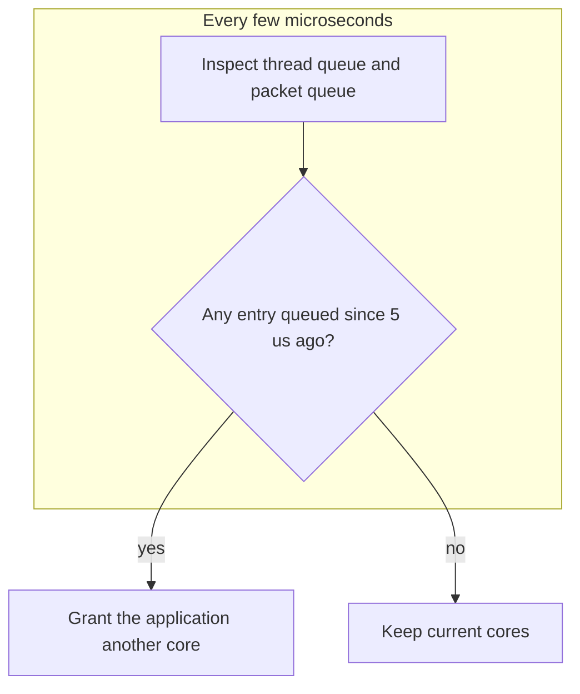

# Datacenter Systems: Shenango

**Shenango** ("Achieving High CPU Efficiency for Latency-sensitive Datacenter Workloads") is a system that reallocates cores across applications at microsecond granularity, so a server can run latency-sensitive and batch applications together without wasting CPU cycles or hurting tail latency.

---

## Motivation

### The OS Is Not Optimized for These Workloads

- People use **kernel bypass** stacks to get the performance they need: applications receive packets directly from the NIC, skipping the kernel overhead.
- Moore's Law is slowing, so we cannot just keep building more servers.
- Yet CPU utilization in datacenters is only **10-66%**. The alternative is to improve existing **CPU efficiency** (the fraction of cycles doing useful work) rather than build more servers.

### Load Variation Makes Efficiency Hard

Load varies on very different time scales:

- **Days**: diurnal cycles.
- **Milliseconds**: packet bursts and thread bursts.

Peak load requires significantly more cores than average load, so provisioning for the peak leaves cores idle most of the time.

### Multiplexing Two Kinds of Applications

- **Latency-sensitive** applications.
- **Batch-processing** applications, which do not need low latency, only high throughput.

Packing both onto the same server uses the idle cores, but existing systems fall short:

| System | Result |
| :--- | :--- |
| Linux | Poor tail latency, which degrades performance, and it cannot sustain high performance. It can multiplex for batch processing, though. |
| Kernel bypass | Superior performance, but low CPU efficiency and throughput |

---

## Goal and Challenges

**Goal**: both CPU efficiency and network performance, by reallocating cores across applications at **microsecond granularity**. Coarser granularities are insufficient for microsecond-scale tasks and microsecond-scale bursts.

Challenges of fast allocation:

- **Application-level metrics are slow** to observe.
- **Multiple sources of load**: threads or packets both affect how many cores an application needs.
- **Overhead of reallocation**: reconfiguring hardware is slow.

---

## Detecting Compute Congestion

Both threads and packets sit in queues, and queueing delay on those queues is the signal.

- **Compute congestion**: if granting an additional thread/core to an application would let it finish its work faster, the application is experiencing compute congestion.
- Policy: grant each application as few cores as possible while avoiding compute congestion.
- **Detection**: queued threads or packets indicate congestion. Check whether any packets or threads have been sitting in the queue since 5 $\mu$s ago; if so, grant another core.
- Queues are implemented as **ring buffers**, which make this check efficient (inspect the head entry's age).

---

## Industry Standard Terms

| Course Term | Industry Equivalent |
| :--- | :--- |
| Kernel bypass stack | DPDK / user-space networking |
| CPU efficiency | CPU utilization (useful cycles) |
| Compute congestion | Run-queue saturation / queueing delay |
| Core reallocation | Core scheduling / elastic CPU allocation |
| Ring buffer | Circular queue / descriptor ring |

---

## Related

- [[Datacenter Systems/Queueing and CPU Scheduling|Queueing and CPU Scheduling]] — Work stealing and multi-level scheduling
- [[Datacenter Systems/Queuing Theory|Queuing Theory]] — Why queueing delay signals congestion
- [[Datacenter Systems/Right-Sizing Datacenters|Right-Sizing Datacenters]] — Utilization and the cost of idle capacity
- [[Datacenter Systems/DMA Ring Buffers|DMA Ring Buffers]]
