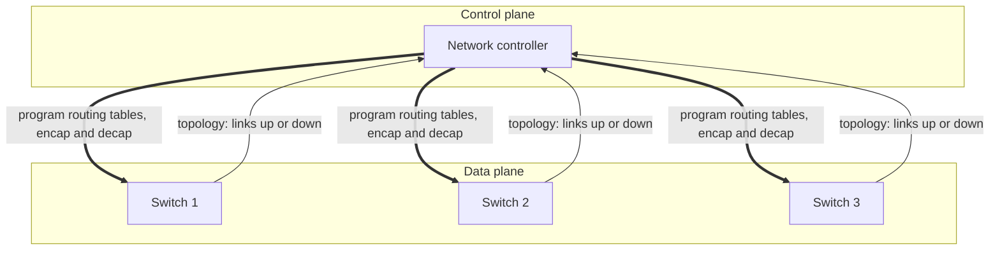
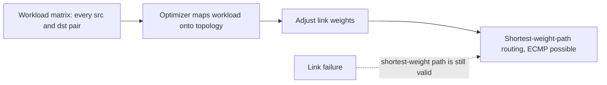

# Datacenter Systems: Software Defined Networks

This note explains why a datacenter network is better run by a central program than by the distributed routing protocols of the internet. It starts with the case for datacenter **[[Networking/Definitions/Software Defined Networking (SDN)|Software Defined Networking (SDN)]]**, then the **separation of the control plane and data plane** that makes it possible, then the two generations of switch programmability (**OpenFlow** and beyond). It ends with how Google applies the same idea outside the datacenter: its external internet connectivity and **B4**, its inter-datacenter network.

---

## The Case for Datacenter SDN

An internet router and a datacenter switch solve similar problems under very different constraints.

| | Internet router | Datacenter network switch |
|---|---|---|
| Buffers | Larger buffers | Relatively small buffers (what fits on chip) |
| Address space | Large, sparse IP address range with complex [[Networking/Definitions/Autonomous System (AS)|AS]] matching | Simple match table for routing, small compact address range |
| Who is in charge | Many operators with many routing policies (slow, distributed [[Networking/Definitions/Border Gateway Protocol (BGP)|BGP]]) | One simple operator controls all switches and endpoints (fast, central control) |

### Why the Internet Router Looks the Way It Does

- **Larger buffers**: the router is the endpoint of expensive long-distance fiber, so it is worth spending more to have fewer packet losses.
  - The extra buffer cost is small relative to the cost of the fiber itself.
- **Large sparse address range and complex AS matching**: the internet is a system of systems made of many different [[Networking/Definitions/Internet Service Provider (ISP)|ISPs]].
- **Interoperability among many routing policies**: BGP is a distributed system that lets a router learn from its neighbors to find the shortest route to a destination.
  - It is mostly **trust based**: a router can advertise that it is the shortest path to a destination while actually being a black hole.
  - ISPs have an economic incentive to not advertise some routes, or to advertise only some of them.

### Why the Datacenter Can Do Better

- A single operator controls every switch and endpoint, so it can make better decisions about how to allocate the IP address range.
  - IPs are allocated hierarchically, which helps routing.
- Datacenters started out using BGP: each switch was individually configured with the IP addresses it manages, and then switches informed each other of those addresses.
- A centralized control is a better way to address two problems BGP had:
  - **Rerouting after a failure**: BGP is slow to reroute when a link or switch fails.
  - **Overflow from a dead link**: when a link is down, traffic overflows onto other links, which causes load-balancing issues.
- The remaining obstacle is that switch hardware is a "black box" with pre-defined software we cannot control. So the switches were opened up to software, letting us define the protocol ourselves.

---

## Separation of Control and Data Plane

- The **data plane** is the switch hardware forwarding packets. The **control plane** decides how packets should be routed.
- In a datacenter, a **network controller** sits in the control plane:
  - It gathers topology information, including which links and switches are up or down.
  - It programs the switch routing tables, encapsulation and decapsulation, and so on.
  - It needs to be highly reliable, with high uptime, because every switch depends on it.
  - It is often configured to communicate with the switches over a separate control network.
- Contrast with internet routing:
  - Routers discover the topology through distributed information exchange.
  - Each router independently decides how to route, and the decisions are made to be globally consistent.

---

## SDN v1: OpenFlow

- Why not allow programmable control over switch routing tables?
  - Routing tables are already supported internally within the switch, and the firmware is programmable.
- Initially, **OpenFlow** was just routing control:
  - **Match** on the packet header.
  - The **action** says which way to route the packet.
  - This simplifies control relative to existing protocols such as BGP.
- The next step added more actions:
  - **Decapsulate** the packet (for a virtual network).
  - **Rewrite** the packet header.

---

## SDN v2: Beyond OpenFlow

SDN v2 widens both halves of the match-action pipeline.

- Expand the capability of the **match** part of the data plane:
  - Programmable packet parsing.
  - A chain of table lookups, larger tables, and shared registers.
- Expand the capability of the **action** part of the data plane:
  - Arithmetic.
  - Add, remove, and update table entries; update registers.
  - Modify packets and add state to packets.
  - Route packets, duplicate packets (multicast), and drop packets.
  - Assign queues, change priorities, and pause or unpause queues.
- Speed: a 30 Tbps switch handles about 50G packets/sec.
- NICs gain similar functionality (see [[Datacenter Systems/Datacenter Networking/Network Interface Cards|Network Interface Cards]]).

These capabilities can be used for traffic monitoring and backpressure flow control. For example, a switch can keep a **per-tenant counter** of the number of bytes the tenant has sent through the switch. That tells us how tenants are sending traffic and how much, so we can assign priority based on what they are paying.

---

## Google's Three Networks: External Internet

Google runs three networks: the one facing the external internet, **B4** between datacenters, and the datacenter network covered above. For the external network the problems come from depending on the internet:

- Connectivity to customers is affected by operations at their ISPs, and everyone in between.
- Route convergence is slow after a failure or misconfiguration.
- Route hijacking: one AS pretends to be another, and there is no failure isolation.
- Google tries to make the network into "their" network for availability.

### Solutions

- Flatten the internet by **peering** directly with every ISP.
- Serve content from servers hosted within every ISP.
- Bypass the internet as much as possible:
  - Lay fiber from Google's network directly to ISPs, bypassing most of the transit internet providers. This reduces the number of hops, and Google builds its own networks.
  - Cache content by running servers inside the ISP network and serving it directly from there: a [[Networking/Definitions/CDN|CDN]].

---

## B4: Google's Inter-Datacenter Network

- At first, B4 was a smaller-scale version of an ISP, with fiber links mostly owned by Google.
- Uses:
  - Data copies of user data for availability and durability.
  - Computation across inherently distributed data.
  - Data push synchronization (content distribution).
- Most traffic is not latency sensitive.
  - Unlike internal datacenter traffic, this means high link utilization is possible.

### Traffic Engineering

Latency inside the datacenter is not included in this analysis, because it is so small.

1. Collect a matrix of the workload between every source/destination pair.
2. An optimizer maps the workload onto the topology.
3. Adjust link weights so that shortest-weight-path routing sends traffic where the optimizer wants.
   - Weight is a function of path latency and path bandwidth (see [[#Formal Analysis]]).
   - Equal cost multipath is possible (see [[Datacenter Systems/Datacenter Networking/ECMP Routing|ECMP Routing]]).
4. If a link fails, the shortest-weight path is still a valid route.

The right routing depends on what the traffic needs:

| Traffic type | Strategy |
|---|---|
| Latency sensitive | Shortest path |
| Bandwidth sensitive | Fill all possible paths (slow to compute, since it is an NP-hard problem) |

### Why B4 Cannot Use BGP

- The topology changes many times per hour because of maintenance and link or switch failures.
- BGP is too slow for this.
- **BBR** fits this setting:
  - It is an end-to-end congestion control protocol, so it does not need anything from the switches. It runs on TCP and replaces its congestion control.
  - It relies on telemetry that the control plane gets.
  - It measures bandwidth and bottleneck link bandwidth.

---

## Formal Analysis

### Formal Definition

For each link $e$, the controller assigns a weight

$$w_e = f(\text{latency}_e,\ \text{bandwidth}_e)$$

and the route for a source/destination pair is the shortest-weight path

$$p^* = \arg\min_{p \in P(s,d)} \sum_{e \in p} w_e$$

where $P(s,d)$ is the set of paths from $s$ to $d$. Equal-weight paths may be used together (ECMP). The optimizer chooses the weights so that the resulting routes carry the workload matrix.

### Simplified Explanation

Instead of every router guessing the best road, one planner looks at all the traffic, puts a toll on each road (high toll means avoid it), and every router just drives the cheapest route. If a road closes, the cheapest remaining route is still a legal route.

---

## Deep Dive

- **OpenFlow match-action**: a switch holds a table of (match, action) entries installed by the controller. The cross-course treatment is in [[Networking/Link Layer/Link Layer - Software Defined Networking (SDN)|Link Layer: Software Defined Networking (SDN)]], and the controller abstraction is the [[Networking/Definitions/Network Operating System (NOS)|Network Operating System (NOS)]].
- **Programmable parsing and chained tables** in SDN v2 are the idea behind data-plane languages such as P4, which describe the parser and the match-action stages of a switch.
- **Why central control can be a risk**: the controller is a single point whose failure affects every switch, which is why the notes above stress high uptime and a separate control network. Switches keep forwarding with their last programmed tables while the controller is unavailable.
- Google's B4 is described in the paper "B4: Experience with a Globally-Deployed Software Defined WAN" (SIGCOMM 2013).

---

## Industry Standard Terms

| Course term | Industry equivalent |
|---|---|
| Network controller | SDN controller / control plane |
| Separation of control and data plane | Control/data plane split |
| OpenFlow match and action | Match-action table (flow table) |
| SDN v2 programmable parsing and tables | Programmable data plane (P4-style pipelines) |
| Per-tenant byte counter | Per-tenant traffic accounting / metering |
| External internet network | Edge network / peering and CDN |
| B4 | Software-defined WAN (SD-WAN) for inter-datacenter traffic |
| Traffic engineering | Centralized traffic engineering (TE) |

---

## Related
- [[Datacenter Systems/Datacenter Networking/Datacenter Networking|Datacenter Networking]]
- [[Datacenter Systems/Datacenter Networking/Network Topology|Network Topology]]
- [[Datacenter Systems/Datacenter Networking/Data Center Congestion Control|Data Center Congestion Control]]
- [[Datacenter Systems/Containers/Network Virtualization|Network Virtualization]]
- [[Datacenter Systems/Containers/Open vSwitch Network Virtualization|Open vSwitch Network Virtualization]]
- [[Networking/Definitions/Software Defined Networking (SDN)|Software Defined Networking (SDN)]]
