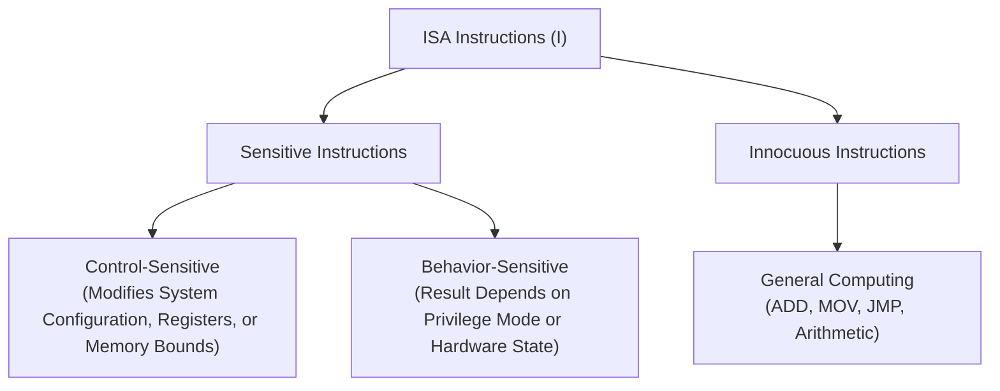

# The Popek-Goldberg Virtualization Theorem: Requirements and System Model

## The Popek-Goldberg Virtualization Theorem Motivation & Overview

In datacenter and cloud environments, virtualization enables multi-tenant resource multiplexing by presenting guest operating systems with an isolated, efficient software duplicate of the underlying physical hardware. A fundamental question in computer architecture is: **Under what conditions can an Instruction Set Architecture (ISA) support a hypervisor without requiring software modification of the guest operating system or prohibitive execution overhead?**

In 1974, Gerald J. Popek and Charles P. Goldberg formalized the necessary and sufficient requirements for a computer architecture to be **strictly virtualizable** via direct hardware execution.

### Core Virtualization Requirements

To construct a valid Virtual Machine Monitor (VMM), the software layer must satisfy three fundamental properties:

1. **Equivalence (Fidelity)**: Any program executing inside a Virtual Machine (VM) must display behavior identical to its execution on the bare-metal physical machine, excluding minor timing variations caused by hypervisor traps or resource sharing.
2. **Safety (Resource Control & Isolation)**: The VMM must retain absolute control over physical hardware resources at all times. No guest software—regardless of privilege level or bugs—can access hardware resources without hypervisor intervention, nor can it breach isolation boundaries to access or corrupt another VM's state.
3. **Performance (Efficiency)**: The vast majority of guest instructions must execute directly on the physical hardware processor at native speed, without software emulation or dynamic instruction translation.

---

## Architecture & Core Mechanics

### System Model & Architectural Assumptions

The Popek-Goldberg model evaluates a conventional **third-generation computer architecture** defined by the following hardware mechanisms:

- **Dual-Mode Execution**: The processor supports at least two distinct execution modes:
  - **Supervisor Mode** ($M = s$): Unrestricted privilege level reserved for the operating system or hypervisor, permitting execution of all hardware instructions and full access to system configuration state.
  - **User Mode** ($M = u$): Restricted privilege level designed for application software, where attempts to execute sensitive or privileged hardware instructions trigger hardware traps.
- **Memory Addressing & Protection**: Physical memory is linear and contiguous (starting at address 0). Address translation and bounds checking are enforced via segment registers $(B, L)$, defining a base physical address $B$ and limit $L$. The valid virtual memory range $(0, L)$ maps linearly to physical memory $[B, B + L]$.
- **Processor Status Word (PSW)**: Hardware status state represented by the tuple $(M, B, L, PC)$, where $M$ is the execution mode, $(B, L)$ are the active segment registers, and $PC$ is the program counter.
- **Hardware Trap Mechanism**: Upon encountering an exception, system call, or privilege violation, the hardware automatically saves the active PSW to a fixed memory location (`MEM[0]`) and loads a new PSW configuration from a predefined vector (`MEM[1]`), transferring control to Supervisor Mode.
- **PSW Reload Capability**: The ISA includes instructions capable of loading $(M, B, L, PC)$ from virtual memory back into the physical PSW, enabling seamless return to User Mode following trap handling.

### Instruction Classification

Popek and Goldberg partitioned all instructions in a physical ISA ($\mathcal{I}$) into three mutually exclusive categories:

1. **Control-Sensitive Instructions**: Instructions that attempt to alter physical resource allocations, change execution privilege levels, disable interrupts, or modify memory mapping parameters (e.g., updating segment base $B$ or limit $L$).
2. **Behavior-Sensitive Instructions**: Instructions whose behavior or execution result depends strictly on the physical execution mode ($M$) or hardware status. An instruction is behavior-sensitive if it behaves differently in Supervisor Mode than in User Mode, or if it exposes hardware state reserved for the operating system (e.g., reading the current execution mode flag or hardware status registers).
3. **Innocuous Instructions**: Instructions that are neither control-sensitive nor behavior-sensitive. These instructions execute identically regardless of privilege level and cannot alter global system configuration (e.g., standard arithmetic, logic, and local control flow instructions).
4. **Privileged Instructions**: Instructions that execute normally when the processor is in Supervisor Mode ($M = s$), but automatically trigger a hardware trap to the supervisor when executed in User Mode ($M = u$).

![[Screenshots/Hardware%20config%20when%20executing%20apps,%20guest%20OS,%20and%20the%20VMM.png]]

## Related

- [[Datacenter Systems/The Popek-Goldberg Virtualization Theorem|The Popek-Goldberg Virtualization Theorem]] — Hub for this topic
- [[Datacenter Systems/The Popek-Goldberg Virtualization Theorem/Trap-and-Emulate Mechanism and Traces|Trap-and-Emulate Mechanism and Traces]] — How traps are emulated, with an interrupt trace
