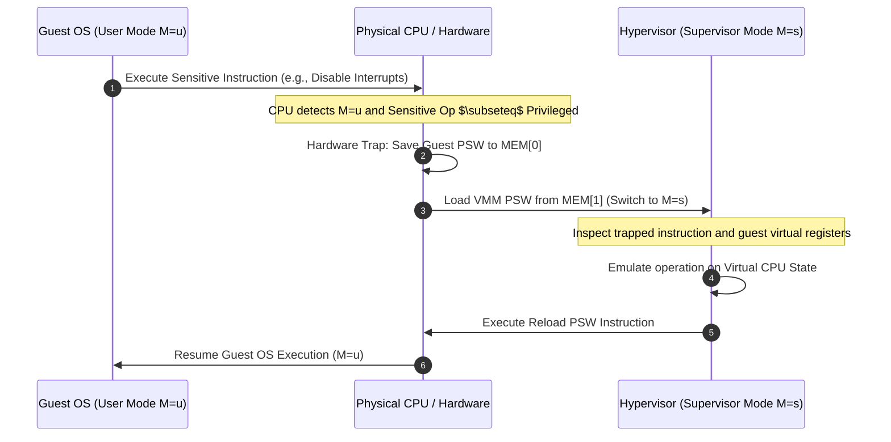

# The Popek-Goldberg Virtualization Theorem: Trap-and-Emulate Mechanism and Traces

## Concrete Walkthrough & Execution Trace

### The Trap-and-Emulate Mechanism

When an ISA satisfies the Popek-Goldberg condition, the VMM runs in physical Supervisor Mode ($M = s$), while the guest operating system and guest applications both execute in physical User Mode ($M = u$).

### Chronological Trace: Virtual Interrupt Handling

1. **Initial State ($t = 0$)**:
   - Physical CPU Execution Mode: User Mode ($M = u$).
   - VMM controls physical hardware state in background ($M = s$).
   - Guest OS is executing kernel code in User Mode ($M = u$), expecting to manipulate hardware state.
2. **Execution ($t = 1$)**:
   - Guest OS issues an instruction to disable interrupts (a control-sensitive operation).
3. **Hardware Trap ($t = 2$)**:
   - Because the instruction is privileged, the physical hardware halts execution of the Guest OS, writes the current PSW $(u, B_{\text{guest}}, L_{\text{guest}}, PC)$ to `MEM[0]`, loads the VMM PSW $(s, B_{\text{vmm}}, L_{\text{vmm}}, PC_{\text{vmm}})$ from `MEM[1]`, and transitions CPU privilege to Supervisor Mode ($M = s$).
4. **Hypervisor Emulation ($t = 3$)**:
   - The VMM inspects the trapped instruction at `MEM[0].PC`, identifies the attempt to disable interrupts, updates the **virtual interrupt flag** in the guest's virtual CPU data structure, and advances the guest's virtual program counter ($PC_{\text{virtual}} \gets PC_{\text{virtual}} + 4$).
5. **Resume Execution ($t = 4$)**:
   - The VMM executes the hardware PSW reload instruction, restoring the Guest PSW $(u, B_{\text{guest}}, L_{\text{guest}}, PC_{\text{virtual}})$ and returning control to the Guest OS in User Mode ($M = u$).

## Industry Standard Terms

| Course Term | Industry / Standard Term |
| :--- | :--- |
| **Trap-and-Emulate** | Classic Hypervisor Trap Interception |

## Related

- [[Datacenter Systems/The Popek-Goldberg Virtualization Theorem|The Popek-Goldberg Virtualization Theorem]] — Hub for this topic
- [[Datacenter Systems/The Popek-Goldberg Virtualization Theorem/Requirements and System Model|Requirements and System Model]] — Core requirements, assumptions, and instruction classification
- [[Datacenter Systems/The Popek-Goldberg Virtualization Theorem/Architectural Violations and Mitigations|Architectural Violations and Mitigations]] — Classic ISAs that break the theorem and their fixes
