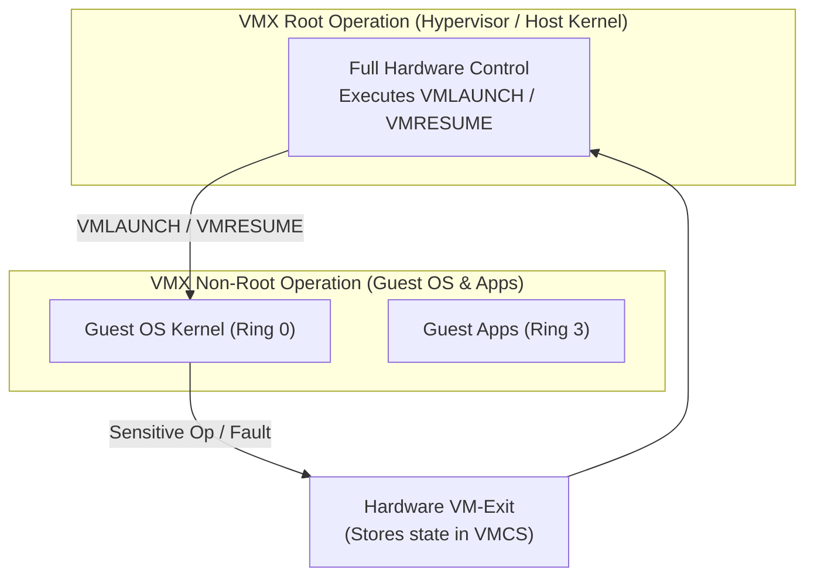

# The Popek-Goldberg Virtualization Theorem: VT-x and EPT Extensions

## Deep Dive

### Hardware-Assisted Extensions: Intel VT-x & Extended Page Tables (EPT)

To permanently resolve the Popek-Goldberg limitation on x86 architectures without requiring software binary translation, Intel introduced **VT-x** technology in 2005.

1. **Orthogonal Privilege Ring Model**: VT-x introduced two parallel hardware operating modes: **VMX Root Operation** and **VMX Non-Root Operation**. Both modes support all traditional privilege rings (Ring 0 through Ring 3).
   - Hypervisors run in **VMX Root Ring 0**.
   - Guest OS kernels run in **VMX Non-Root Ring 0**.
   - Guest applications run in **VMX Non-Root Ring 3**.
2. **Virtual Machine Control Structure (VMCS)**: A 4 KB physical memory structure containing guest-state area, host-state area, VM-Execution control fields, and VM-Exit cause indicators.
3. **Second Level Address Translation (SLAT / EPT)**: Hardware-assisted memory virtualization mapping Guest Virtual Addresses (GVA) $\to$ Guest Physical Addresses (GPA) $\to$ Host Physical Addresses (HPA) directly in CPU Memory Management Unit (MMU) hardware, eliminating hypervisor shadow page table overhead.

## Related

- [[Datacenter Systems/The Popek-Goldberg Virtualization Theorem|The Popek-Goldberg Virtualization Theorem]] — Hub for this topic
- [[Datacenter Systems/The Popek-Goldberg Virtualization Theorem/Formal Definition|Formal Definition]] — Formal statement of the theorem
