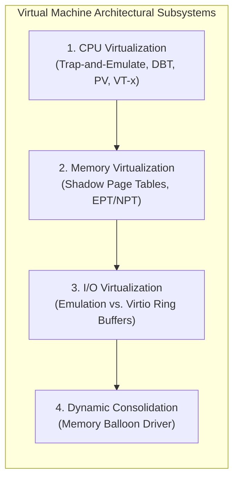

# Datacenter Systems: Virtual Machines

Virtual machine implementations virtualize physical CPU execution, system memory hierarchies, and hardware I/O by presenting untrusted guest operating systems with the illusion of running directly on bare-metal hardware, utilizing privilege deprivileging, trap-and-emulate, dynamic binary translation, paravirtualization, shadow page tables, nested hardware paging, and memory ballooning to preserve multi-tenant isolation, security, and near-native performance.

Virtual machine architectures combine low-level CPU instruction trapping, dynamic binary rewriting, paravirtualized cooperation, and hardware virtualization extensions across compute, memory, and storage.

## Topics

- [[Datacenter Systems/Virtual Machines/Motivation and Trade-offs|Motivation and Trade-offs]] — The three virtues, core challenges, and benefits/costs of VMs
- [[Datacenter Systems/Virtual Machines/CPU Virtualization Mechanisms|CPU Virtualization Mechanisms]] — Trap-and-emulate, binary translation, paravirtualization, VT-x/AMD-V, and the Popek-Goldberg condition
- [[Datacenter Systems/Virtual Machines/Memory Virtualization Foundations|Memory Virtualization Foundations]] — Paging recap, the GVA/GPA/HPA hierarchy, and the composite translation
- [[Datacenter Systems/Virtual Machines/Software Memory Virtualization|Software Memory Virtualization]] — Real guest page tables, shadow page tables, and paravirtualized memory management
- [[Datacenter Systems/Virtual Machines/Nested Paging with EPT and NPT|Nested Paging with EPT and NPT]] — Hardware two-dimensional page walks, superpages, VPID, and page modification logging
- [[Datacenter Systems/Virtual Machines/KVM Memory Virtualization|KVM Memory Virtualization]] — GPA to HVA mapping and software instruction emulation in KVM
- [[Datacenter Systems/Virtual Machines/Memory Ballooning|Memory Ballooning]] — Overcommitment, double paging, and the balloon driver
- [[Datacenter Systems/Virtual Machines/Edge Cases and Failure Modes|Edge Cases and Failure Modes]] — Failure modes across CPU, memory, and consolidation mechanisms

## Related

- [[Datacenter Systems/IO Virtualization|I/O Virtualization]] — Virtual-to-physical I/O interposition, VM encapsulation, live migration, and paravirtualized Virtio queues
- [[Datacenter Systems/Course Introduction and Overview|Course Introduction and Overview]] — Foundations of warehouse-scale computing, the Cloud Operator Pyramid of Concerns, and infrastructure trade-offs
- [[Datacenter Systems/Execution Environments and Virtualization|Execution Environments and Virtualization]] — Broad datacenter workload taxonomy, limits of process isolation, three-tier memory hierarchies, and live VM migration
- [[Datacenter Systems/The Popek-Goldberg Virtualization Theorem|The Popek-Goldberg Virtualization Theorem]] — Formal ISA conditions for direct execution virtualization, x86/ARM hardware violations, and Popek-Goldberg proofs
- [[Operating Systems/Memory/Virtual Memory|Virtual Memory]] — Paging, Translation Lookaside Buffers (TLBs), multi-level page tables, and address translation
- [[Operating Systems/Virtualization/Containers and Virt|Containers and Virtualization]] — Hypervisor hardware isolation vs. operating system kernel namespaces and cgroups
- [[Operating Systems/Virtualization/Virtual Machine/Virtual Machine|Virtual Machines]] — Kernel-level virtualization abstractions and classic shadow paging implementations
- [[CSE451 Index|CSE451 — Operating Systems]] — Kernel privilege levels, system call interfaces, virtual address space management, and context switching
- [[CSE351 Index|CSE351 — The Hardware/Software Interface]] — x86-64 assembly, processor privilege rings, page table structures, and hardware exception handling
- [[Datacenter Systems/Index|Datacenter Systems Index]] — Master navigation index for datacenter architecture and system software notes
