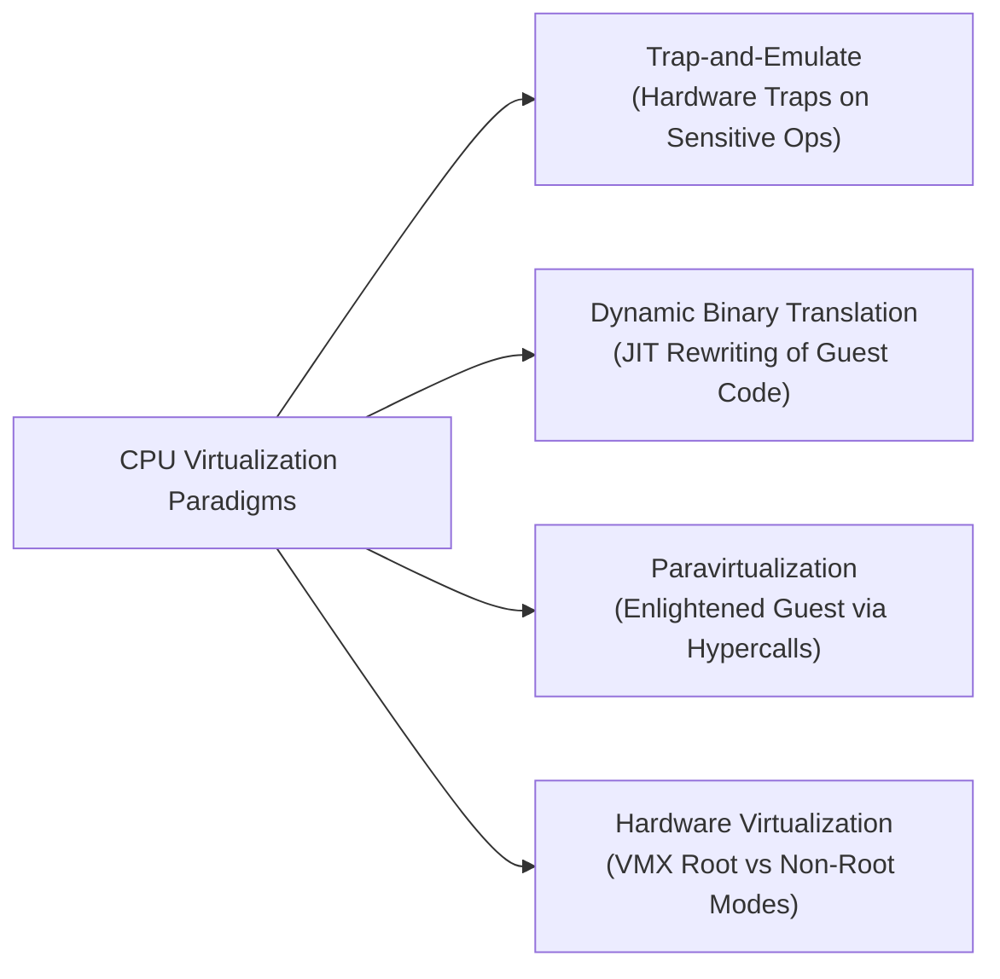

# Virtual Machines: CPU Virtualization Mechanisms

## Part 1: CPU Virtualization Mechanisms

Computer systems employ four foundational software and hardware architectures to virtualize CPU instruction execution:

### 1. Trap-and-Emulate
- **Direct Execution**: Unprivileged, non-sensitive instructions issued by the Guest OS or guest applications run directly on physical CPU cores at native bare-metal speed.
- **Hardware Trapping**: When the Guest OS attempts to execute a privileged or sensitive instruction (such as altering processor status registers or updating page table bases), the underlying CPU hardware raises a hardware trap to the host hypervisor.
- **Hypervisor Emulation**: The hypervisor intercepts the trap, saves guest register state, emulates the intended side-effect of the instruction on virtual hardware state, advances the virtual program counter ($PC$), and resumes guest execution.
- **Fundamental Limitation**: Trap-and-emulate relies strictly on hardware trapping *every* sensitive instruction. If an instruction is sensitive but fails to trap in user mode (e.g., silently returning incorrect status without trapping, as in early x86 architectures), pure trap-and-emulate fails (as formalized in [[Datacenter Systems/The Popek-Goldberg Virtualization Theorem|The Popek-Goldberg Virtualization Theorem]]).

### 2. Dynamic Binary Translation (DBT)
When hardware ISAs contain non-virtualizable instructions and lack hardware extensions, hypervisors employ **Dynamic Binary Translation**:
- **Dual Execution Model**: Guest user code executes directly on CPU hardware. Guest kernel binary code is parsed and dynamically translated by the hypervisor at runtime via Just-In-Time (JIT) compilation.
- **Basic Block Decomposition**: The translation engine subdivides guest kernel binary streams into **basic blocks** (straight-line instruction sequences ending in a branch, jump, or return).
- **Control Flow Graph (CFG) Rewriting**: The VMM parses basic blocks, identifies non-trapping sensitive instructions, and replaces them with inline hypervisor routines or safe instructions before caching the compiled basic block in a host-memory Translation Cache (`TCache`).
- **Optimization**: Exploits untaken branches, contiguous basic block cache locality, and register allocation mapping (e.g., utilizing host 64-bit registers to emulate 32-bit guest registers).

### 3. Paravirtualization (PV)
- **Guest Enlightenment**: Rather than attempting to fool an unmodified Guest OS into believing it runs on bare metal, the Guest OS kernel source code is modified to be explicitly aware that it is running inside a virtualized environment.
- **Hypercall Interface**: Sensitive instructions are replaced with explicit **Hypercalls** (software traps or dedicated instructions such as `VMCALL` / `VMMCALL`, analogous to system calls from user processes to OS kernels).
- **Batching & Coordination**: The guest kernel batches multiple operations (e.g., updating multiple page table entries) into a single hypercall, drastically reducing hypervisor context switch frequency.
- **Trade-off**: High performance, but requires access to guest kernel source code and extensive kernel engineering for every supported guest operating system.

### 4. Hardware-Assisted Virtualization (Intel VT-x & AMD-V)
Modern production datacenters rely primarily on hardware virtualization extensions built into physical processor silicon:
- **Dual Privilege Mode Architecture**: Introduces two hardware operational modes orthogonal to traditional Rings 0–3:
  - **VMX Root Mode**: Full hardware privilege mode reserved for the host hypervisor (Host Ring 0).
  - **VMX Non-Root Mode**: Deprivileged mode dedicated to guest VM execution. The Guest OS kernel executes in Non-Root Ring 0, while Guest Applications execute in Non-Root Ring 3.
- **Virtual Machine Control Structure (VMCS / VMCB)**: A 4KB physical memory structure configured by the hypervisor and managed by CPU hardware. It contains:
  - *Guest-State Area*: Registers, control registers ($CR0, CR3, CR4$), and execution state loaded automatically during VM-Entry.
  - *Host-State Area*: Hypervisor registers and page table roots loaded automatically during VM-Exit.
  - *VM-Execution Controls*: Bitmaps specifying precisely which guest operations trigger hardware exits.
- **Hardware Lifecycle**:
  - Guest system calls from Non-Root Ring 3 trap directly into the Guest OS in Non-Root Ring 0 with **zero hypervisor overhead**.
  - Sensitive operations trigger a hardware **VM-Exit**, atomically saving guest state into the VMCS, loading host state, and returning control to the hypervisor in Root Mode.
  - The hypervisor handles the event and executes `VMRESUME` (or `VMLAUNCH`) to perform a **VM-Entry** back into the guest.

### 5. I/O Virtualization & Paravirtualization
Virtualizing I/O devices via software interposition allows hypervisors to encapsulate VM state, migrate VMs across heterogeneous hardware, and aggregate physical devices.
- Pure hardware device emulation requires hundreds of VM-Exits per I/O request due to PIO/MMIO accesses.
- To avoid this, modern hypervisors utilize **paravirtualized I/O** (e.g., virtio), where guests place requests directly into shared-memory ring buffers and signal the host via a single hypercall/doorbell.
- *See the dedicated topic note:* [[Datacenter Systems/IO Virtualization|I/O Virtualization]]

## 3. Dual-Layer Explanation: The Popek-Goldberg Virtualization Theorem

### Formal Definition
An ISA $\mathcal{I}$ is strictly virtualizable under pure trap-and-emulate if and only if all sensitive instructions $\mathcal{I}_{\text{sensitive}}$ are a subset of privileged instructions $\mathcal{I}_{\text{privileged}}$:

$$\mathcal{I}_{\text{sensitive}} \subseteq \mathcal{I}_{\text{privileged}}$$

Where:
$$\mathcal{I}_{\text{sensitive}} = \{ i \in \mathcal{I} \mid i \text{ modifies hardware config or behavior varies by privilege ring} \}$$
$$\mathcal{I}_{\text{privileged}} = \{ i \in \mathcal{I} \mid i \text{ triggers a hardware trap when executed in user mode} \}$$

### Simplified Explanation
If an operating system instruction does something important—like checking the CPU privilege ring or changing page table mappings—the hardware *must* throw an exception if a non-root program tries to run it. If it fails silently or returns fake information without trapping, pure trap-and-emulate is impossible.

## Industry Standard Terms

| Course Term | Industry / Standard Term | Production Implementation Examples |
| :--- | :--- | :--- |
| **Root Mode / Non-Root Mode** | **VMX Root / VMX Non-Root** | Intel VT-x VMX modes, AMD-V SVM Host/Guest modes |
| **Cooperative Call into Hypervisor** | **Hypercall** | `VMCALL` (Intel), `VMMCALL` (AMD), `hvc` (ARM) |
| **Special Device Drivers** | **Paravirtualized Drivers / Virtio** | `virtio-net`, `virtio-blk`, AWS ENA, VMware Tools |

## Related

- [[Datacenter Systems/Virtual Machines|Virtual Machines]] — Hub for this topic
- [[Datacenter Systems/Virtual Machines/Motivation and Trade-offs|Motivation and Trade-offs]] — The three virtues, core challenges, and benefits/costs of VMs
- [[Datacenter Systems/Virtual Machines/Memory Virtualization Foundations|Memory Virtualization Foundations]] — Paging recap, the GVA/GPA/HPA hierarchy, and the composite translation
