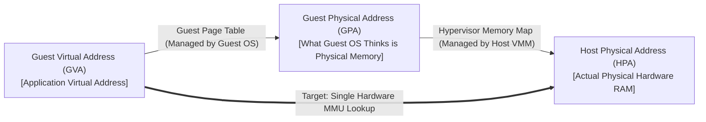

# Virtual Machines: Memory Virtualization Foundations

## Part 2: Memory Virtualization Mechanisms

Memory virtualization presents untrusted guest operating systems with the illusion of contiguous, physical system memory while mapping all guest allocations into host physical RAM.

### Virtual Memory Foundations & Paging Recap
In a standard native operating system, the kernel manages a virtual memory subsystem:
- Operating system page tables map virtual page numbers (VPNs) to physical frame numbers (PFNs), providing each process with an isolated virtual address space.
- Page table entries (PTEs) store permissions (Read, Write, Execute, Present, User/Supervisor).
- On x86-64 architectures, canonical 48-bit virtual addresses are translated via a **4-level hierarchical page table walk** (`PML4` $\longrightarrow$ `PDPT` $\longrightarrow$ `PD` $\longrightarrow$ `PT`).
- The hardware **Translation Lookaside Buffer (TLB)** serves as an associative cache for virtual-to-physical translations:

![[Screenshots/x86-64 paging.png]]

- **Page Walk Cost**: Walking 4 levels of page tables on every TLB miss requires 4 sequential memory reads. CPU architectures cache intermediate page directory entries in hardware page-walk caches to accelerate resolution.

---

### The Three-Tier Address Hierarchy

In a virtualized environment, an additional tier of address abstraction is introduced, creating three distinct address spaces:

![[Screenshots/Virtual to Physical Address Translation Hierarchy.png]]

- **Guest Virtual Address (GVA)**: The virtual memory address generated by an application executing inside the guest VM.
- **Guest Physical Address (GPA)**: The contiguous physical address space presented to the Guest OS. The Guest OS allocates physical frames and constructs its page tables using GPAs.
- **Host Physical Address (HPA)**: The actual physical silicon DRAM addresses on the host motherboard.
- **The Core Constraint**: The physical CPU Memory Management Unit (MMU) only understands one physical translation path. When the processor executes an instruction (e.g., `mov rax, [addr]`), the hardware MMU must resolve a **Guest Virtual Address (GVA) directly into a Host Physical Address (HPA)** in a single translation pipeline!

Four distinct mechanisms have evolved to bridge this three-tier translation challenge:

## 1. Three-Tier Address Translation Mapping

Let $\text{GVA}$ represent Guest Virtual Address space, $\text{GPA}$ represent Guest Physical Address space, and $\text{HPA}$ represent Host Physical Address space:

$$\tau_{\text{guest}}: \text{GVA} \longrightarrow \text{GPA}, \quad \text{managed by Guest OS via } gCR3$$
$$\tau_{\text{host}}: \text{GPA} \longrightarrow \text{HPA}, \quad \text{managed by Hypervisor via } \text{EPTP}$$

The composite hardware translation function executed by the MMU is:

$$\tau_{\text{composite}} = \tau_{\text{host}} \circ \tau_{\text{guest}}: \text{GVA} \longrightarrow \text{HPA}$$

- Under **Shadow Page Tables**: The hypervisor pre-computes $\tau_{\text{composite}}$ in software and loads it into the physical CPU $CR3$.
- Under **Hardware Nested Paging (EPT)**: The hardware MMU dynamically computes $\tau_{\text{host}}(\tau_{\text{guest}}(\text{GVA}))$ in hardware silicon on every TLB miss.

## Related

- [[Datacenter Systems/Virtual Machines|Virtual Machines]] — Hub for this topic
- [[Datacenter Systems/Virtual Machines/CPU Virtualization Mechanisms|CPU Virtualization Mechanisms]] — Trap-and-emulate, binary translation, paravirtualization, VT-x/AMD-V, and the Popek-Goldberg condition
- [[Datacenter Systems/Virtual Machines/Software Memory Virtualization|Software Memory Virtualization]] — Real guest page tables, shadow page tables, and paravirtualized memory management
