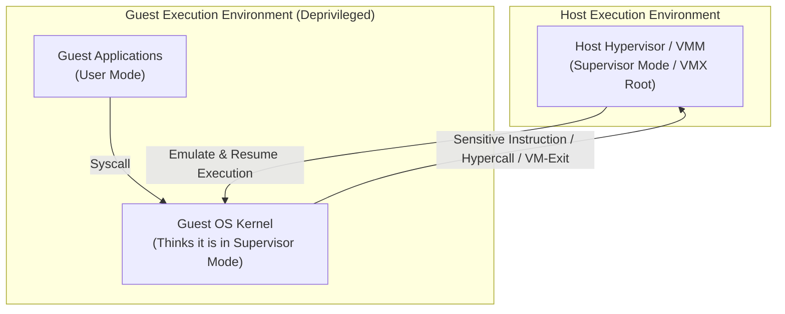

# Virtual Machines: Motivation and Trade-offs

## Virtual Machines Motivation & Overview

In cloud datacenters, virtualization multiplexes heterogeneous workloads from multiple competing tenants onto shared physical hardware. Operating system kernels are inherently designed with the assumption that they have exclusive, unconstrained authority over physical execution rings, hardware control registers, page tables, memory management units (MMUs), and I/O devices. 

Running an untrusted guest operating system (Guest OS) in host kernel mode (Ring 0 / Supervisor mode) would destroy host isolation: a single compromised or misconfigured tenant could inspect private physical memory belonging to co-located tenants, modify hardware page tables, or crash the physical server.

### The Three Virtues of Virtualization

A correct Virtual Machine Monitor (VMM / Hypervisor) must satisfy three foundational system invariants:
1. **Fidelity (Equivalence)**: The Guest OS and guest applications must observe identical behavior, state transitions, and register side-effects as if executing directly on native physical hardware.
2. **Safety & Isolation (Resource Control)**: The hypervisor retains complete, irrevocable authority over physical hardware resources (CPU cores, physical DRAM, network cards, and storage devices). No guest execution can escape its sandbox or corrupt host state.
3. **Performance (Efficiency)**: The vast majority of innocuous, non-sensitive instructions must execute directly on physical processor silicon at native speed without hypervisor mediation.

### Core Virtualization Challenges

Achieving these properties across modern computer systems requires addressing three primary subsystems:
- **CPU Virtualization**: Safely executing a deprivileged guest kernel while handling privileged and sensitive processor instructions.
- **Memory Virtualization**: Mapping guest-managed virtual memory to host physical memory through a single hardware MMU translation while maintaining full page isolation across VMs.
- **I/O and Resource Virtualization**: Handling device access and dynamically balancing physical resources across variable tenant demands.

### Architectural Trade-offs: Benefits and Costs of Virtual Machines

#### Core Benefits of Virtual Machines
- **Workload Encapsulation**: A VM encapsulates the complete runtime execution environment (operating system, system libraries, configuration, and application binaries), decoupling workloads from the underlying physical server.
- **Server Consolidation**: Multiplexes many heterogeneous, low-utilization workloads onto fewer physical machines, driving average server utilization from 10–15% up to 60–80%.
- **Advanced Failure Recovery & Management**: Virtual machine state is encapsulated in software structures and disk images, enabling live migration, instantaneous snapshots, and rapid disaster recovery.
- **Explicit Resource Allocation**: Operators can enforce precise, strict resource allocations (dedicated vCPUs, memory bounds) per guest VM.
- **Hardware Independence**: Applications and legacy operating systems run unmodified across different generations of host hardware, provided the hypervisor presents the standard hardware abstraction.

#### Architectural Costs and Overheads of Virtual Machines
- **Kernel Duplication & Memory Bloat**: Every user or application requires its own complete copy of the operating system kernel in RAM. A guest operating system (GOS) demands a baseline footprint of at least 1 GB of memory, regardless of application size.
- **Coarse-Grained Resource Allocation**: Resources are carved out in coarse increments (e.g., 2 MB to 1 GB page allocations), exacerbating memory fragmentation for lightweight services.
- **Extensive Hardware Requirements**:
  - Requires dedicated processor extensions (VT-x / AMD-V) to execute guest kernels.
  - Two-dimensional page table lookups (EPT / NPT) introduce significant latency on TLB misses (up to 24 memory accesses for a 4-level page walk).
  - Requires hardware-assisted virtual I/O, IOMMU (VT-d / AMD-Vi), and posted interrupt delivery to avoid devastating `vmexit` trap-and-emulate penalties.
  - Requires software-defined networking layers to virtualize MAC and IP addresses for every VM.

## Industry Standard Terms

| Course Term | Industry / Standard Term | Production Implementation Examples |
| :--- | :--- | :--- |
| **Guest OS Deprivileging** | **Ring Deprivileging / Ring Compression** | Running Guest Kernel in Ring 1/3 (Software) or Non-Root Ring 0 (VT-x) |
| **2D Page Walk** | **Two-Dimensional MMU Translation** | Hardware MMU walking guest PT interleaved with host EPT |

## Related

- [[Datacenter Systems/Virtual Machines|Virtual Machines]] — Hub for this topic
- [[Datacenter Systems/Virtual Machines/CPU Virtualization Mechanisms|CPU Virtualization Mechanisms]] — Trap-and-emulate, binary translation, paravirtualization, VT-x/AMD-V, and the Popek-Goldberg condition
