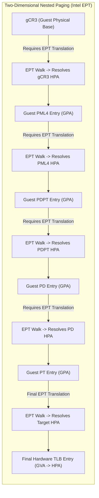

# Virtual Machines: Nested Paging with EPT and NPT

## Mechanism 4: Hardware-Assisted Nested Paging (Intel EPT & AMD NPT)

Modern virtualization hardware integrates two-dimensional address translation directly into the physical CPU MMU, eliminating the need for software shadow page tables entirely.

Intel designates this technology **Extended Page Tables (EPT)**; AMD designates it **Nested Page Tables (NPT)**.



## The Two-Dimensional Page Table Walk
Under EPT, the hardware MMU maintains two distinct base registers:
1. **`gCR3`**: Guest $CR3$ register containing the Guest Physical Address (GPA) of the guest root page directory (`PML4`).
2. **`EPTP`**: Extended Page Table Pointer (stored in the VMCS) containing the Host Physical Address (HPA) of the host EPT root.

When a guest instruction encounters a TLB miss, the physical hardware MMU autonomously executes a **Two-Dimensional Page Walk**:

![[Screenshots/Hardware Support for Virtual Machine Memory.png]]

- To access the Guest PML4 root, the MMU must read `gCR3`. But because `gCR3` is a **Guest Physical Address**, the hardware must first walk all 4 levels of the EPT to find the HPA of the PML4 table! (Host reads 1, 2, 3, 4 $\to$ Guest read 5).
- To access the Guest PDPT entry, the pointer inside the PML4 is a GPA, requiring another 4-level EPT walk! (Host reads 6, 7, 8, 9 $\to$ Guest read 10).
- To access the Guest PD entry, another 4-level EPT walk occurs! (Host reads 11, 12, 13, 14 $\to$ Guest read 15).
- To access the Guest PT entry, another 4-level EPT walk occurs! (Host reads 16, 17, 18, 19 $\to$ Guest read 20).
- Finally, the GPA of the actual data page requires a final 4-level EPT walk! (Host reads 21, 22, 23, 24 $\to$ Target HPA).
- **Total Memory Reads**: **24 sequential memory lookups (+1 data load)** to resolve a single TLB miss!

## Why Hardware Nested Paging Outperforms Shadow Page Tables
Despite requiring up to 24 memory reads on a cold TLB miss, EPT vastly outperforms Shadow Page Tables in production:
1. **Zero Hypervisor Traps**: Page table updates, allocations, and context switches execute inside Non-Root Mode without triggering a single VM-Exit.
2. **Hardware Cache Locality**: Because page table structures exhibit high temporal and spatial locality, nearly all intermediate EPT entries hit in the processor's ultra-fast L1, L2, and L3 CPU caches.
3. **Hardware Page-Walk Caches**: Modern CPUs cache intermediate EPT directory entries, collapsing the effective memory access latency to near-native levels.

## The Crucial Role of 2MB Superpages
The performance of hardware-assisted paging depends heavily on page size:

![[Screenshots/Performance of Virtual Machine Memory.png]]

- **4KB Paging Overhead**: Under standard 4KB paging, an EPT TLB miss requires walking all 4 levels of both tables, incurring over **800 CPU clock cycles** per miss.
- **2MB Superpage Optimization**: By configuring the hypervisor to allocate memory in **2MB large pages (superpages)**, the lowest translation level is eliminated. The translation walk terminates at the Page Directory level, slashing TLB miss latency from ~800 cycles to **~340 cycles**—a dramatic $58\%$ performance improvement!
- **1GB vs 2MB Superpages Trade-off**: By utilizing **1GB huge pages** ($L_{\text{host}} = 2$), the EPT walk stops even earlier, providing the absolute fastest performance closest to bare-metal execution. However, 1GB pages introduce massive physical memory fragmentation and stranded capacity, making **2MB superpages the universal standard** in production multi-tenant datacenters.

## Trace 2: Two-Dimensional EPT Page Walk on Cold TLB Miss

```
Initial System State:
  Guest Application accesses GVA = 0x0000_7FFF_8000_1000
  Hardware TLB: Cold Miss
  Guest Base Register: gCR3 = GPA 0x0000_0001_2000_0000
  Host Base Register: EPTP = HPA 0x0000_0004_1000_0000

Step-by-Step Two-Dimensional Memory Access Sequence:
  [Phase 1: Locate Guest PML4 Root in Host Physical Memory]
    1. Read Host EPT PML4[idx_EPTP]           -> Resolves EPT PDPT HPA
    2. Read Host EPT PDPT[idx]                -> Resolves EPT PD HPA
    3. Read Host EPT PD[idx]                  -> Resolves EPT PT HPA
    4. Read Host EPT PT[idx]                  -> Resolves HPA of Guest PML4 Root
    5. Read Guest PML4[GVA.idx4]              -> Resolves GPA of Guest PDPT

  [Phase 2: Locate Guest PDPT in Host Physical Memory]
    6. Read Host EPT PML4                     -> Resolves EPT PDPT HPA
    7. Read Host EPT PDPT                     -> Resolves EPT PD HPA
    8. Read Host EPT PD                       -> Resolves EPT PT HPA
    9. Read Host EPT PT                       -> Resolves HPA of Guest PDPT
    10. Read Guest PDPT[GVA.idx3]             -> Resolves GPA of Guest PD

  [Phase 3: Locate Guest PD in Host Physical Memory]
    11. Read Host EPT PML4                    -> Resolves EPT PDPT HPA
    12. Read Host EPT PDPT                    -> Resolves EPT PD HPA
    13. Read Host EPT PD                      -> Resolves EPT PT HPA
    14. Read Host EPT PT                      -> Resolves HPA of Guest PD
    15. Read Guest PD[GVA.idx2]               -> Resolves GPA of Guest PT

  [Phase 4: Locate Guest PT in Host Physical Memory]
    16. Read Host EPT PML4                    -> Resolves EPT PDPT HPA
    17. Read Host EPT PDPT                    -> Resolves EPT PD HPA
    18. Read Host EPT PD                      -> Resolves EPT PT HPA
    19. Read Host EPT PT                      -> Resolves HPA of Guest PT
    20. Read Guest PT[GVA.idx1]               -> Resolves GPA of Target Data Page

  [Phase 5: Locate Target Data Page in Host Physical Memory]
    21. Read Host EPT PML4                    -> Resolves EPT PDPT HPA
    22. Read Host EPT PDPT                    -> Resolves EPT PD HPA
    23. Read Host EPT PD                      -> Resolves EPT PT HPA
    24. Read Host EPT PT                      -> Resolves HPA of Target Data Page

Final State:
  Hardware TLB populated with direct translation: GVA 0x7FFF_8000_1000 -> HPA 0x9A20_1000.
  Total Lookups: Exactly 24 memory reads.
  Subsequent memory accesses to this page hit directly in TLB (0 memory reads).
```

## 2. Nested Page Walk Memory Access Complexity (Quadratic Lookup Algorithm)

Let $n$ be the depth of the guest hierarchical page table ($L_{\text{guest}}$), and let $m$ be the depth of the host EPT table ($L_{\text{host}}$). The total number of memory reads $N_{\text{reads}}$ required to resolve a TLB miss follows a quadratic lookup algorithm $O(n \cdot m)$ since every guest page table read requires a full host page walk:

$$N_{\text{reads}} = n \times m + n + m = (n + 1) \cdot m + n$$

For standard 64-bit 4-level paging ($n = 4, m = 4$):

$$N_{\text{reads}} = 4 \times 4 + 4 + 4 = 16 + 4 + 4 = 24 \text{ memory lookups}$$

When the hypervisor backs guest memory with **2MB Superpages** ($L_{\text{host}} = 3$):

$$N_{\text{reads, 2MB}} = (4 + 1) \cdot 3 + 4 = 15 + 4 = 19 \text{ memory lookups}$$

If the guest OS *also* uses 2MB superpages ($L_{\text{guest}} = 3, L_{\text{host}} = 3$):

$$N_{\text{reads, dual 2MB}} = (3 + 1) \cdot 3 + 3 = 12 + 3 = 15 \text{ memory lookups}$$

## Deep Dive

### 1. Virtual Processor IDs (VPID)
Prior to modern VT-x enhancements, every VM-Exit and VM-Entry forced a complete flush of the processor TLB. This meant that after every I/O event or hypervisor interrupt, the guest CPU suffered thousands of cold cache misses.
- **Intel VPID** adds a 16-bit architectural tag to all hardware TLB entries.
- The hardware checks the current VM's VPID on memory access.
- When a VM-Exit occurs, the hypervisor operates under VPID `0x0000`, while the guest operates under its assigned VPID (e.g., `0x0001`).
- TLB entries persist across transitions, completely eliminating TLB flushing overhead during context switches.

### 2. EPT Accessed and Dirty (A/D) Bits & Page Modification Logging (PML)
For live virtual machine migration and memory checkpointing, the hypervisor must track which memory pages the guest writes to:
- Historically, the hypervisor marked all EPT entries read-only, trapping on every write (`EPT Violation`) to track dirty pages.
- Modern Intel processors implement **Hardware EPT A/D bits**: hardware sets the Dirty bit in the EPT entry automatically without generating a VM-Exit.
- **Page Modification Logging (PML)**: The processor automatically appends the Guest Physical Frame Number (GFN) of any modified page to a 512-entry host memory buffer. When the buffer fills, a single VM-Exit occurs, allowing zero-overhead live VM migration in high-throughput datacenter clouds.

## Industry Standard Terms

| Course Term | Industry / Standard Term | Production Implementation Examples |
| :--- | :--- | :--- |
| **Hardware Trap to VMM** | **VM-Exit** | Intel VT-x `VM-Exit`, AMD-V `#VMEXIT` |
| **Hardware-Assisted Paging** | **Nested Paging / Two-Dimensional Paging** | Intel EPT (Extended Page Tables), AMD NPT / RVI (Nested Page Tables) |
| **Superpage Optimization** | **Huge Pages / Transparent Huge Pages (THP)** | 2MB Huge Pages (`hugetlbfs`), 1GB Gigapages |

## Related

- [[Datacenter Systems/Virtual Machines|Virtual Machines]] — Hub for this topic
- [[Datacenter Systems/Virtual Machines/Software Memory Virtualization|Software Memory Virtualization]] — Real guest page tables, shadow page tables, and paravirtualized memory management
- [[Datacenter Systems/Virtual Machines/KVM Memory Virtualization|KVM Memory Virtualization]] — GPA to HVA mapping and software instruction emulation in KVM
