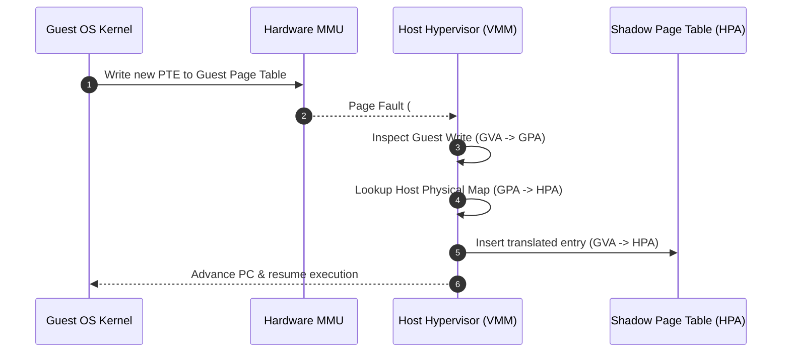

# Virtual Machines: Software Memory Virtualization

## Mechanism 1: Real Guest Page Tables (Pure Trap-and-Emulate)

The simplest conceptual approach is for the hypervisor to manage the real page table directly:

![[Screenshots/Real Guest PT.png]]

- **Execution Mechanics**:
  - The hypervisor directly controls the hardware page table used by the CPU MMU.
  - The Guest OS kernel attempts to manage its own page tables in software.
  - Whenever the Guest OS attempts to access, read, or update its page tables, the operation traps into the hypervisor.
  - On a store (write): The hypervisor intercepts the write, translates the guest GPA into a host HPA, and writes the real PTE.
  - On a load (read): The hypervisor intercepts the read, translates the real HPA back into a virtual GPA, and presents the synthetic PTE to the guest.
- **Performance Failure Mode**: Because **every single guest page table access traps**—including read accesses—the virtualization overhead is catastrophic. This approach is completely unusable in production systems.

---

## Mechanism 2: Shadow Page Tables (SPT)

To eliminate traps on page table reads, early production hypervisors (such as VMware ESXi and early Xen) introduced **Shadow Page Tables (SPT)**:

![[Screenshots/Shadow Page Table.png]]

- **Architectural Separation**:
  - The Guest OS allocates and manages its own page table in guest memory (**Guest Page Table, GPT**), mapping $\text{GVA} \longrightarrow \text{GPA}$.
  - The hypervisor maintains an internal physical address map mapping $\text{GPA} \longrightarrow \text{HPA}$.
  - The hypervisor constructs a secondary, synthetic page table (**Shadow Page Table, SPT**) that maps $\text{GVA} \longrightarrow \text{HPA}$ directly.
- **Hardware MMU Pointer**:
  - The physical CPU's control register ($CR3$) points **exclusively to the Shadow Page Table in host memory**, never to the Guest Page Table!
  - When guest code executes, the hardware MMU and TLB read directly from the Shadow Page Table.
  - **Reads do NOT trap**: The Guest OS reads its own page tables natively without hypervisor intervention.
- **Write Interception via Write Protection & Heuristics**:
  - Guest page tables can be allocated anywhere in physical memory and reallocated dynamically at the discretion of the Guest OS.
  - To keep the Shadow Page Table synchronized, the hypervisor relies on **memory tracing**: it uses heuristics to identify guest pages that contain page tables, and marks those pages as **Read-Only (Write-Protected)** in the Shadow Page Table.
  - When the Guest OS attempts to write to a PTE (e.g., allocating a page or updating permissions), the hardware MMU raises a Page Fault (`#PF`), which traps into the hypervisor.
  - The hypervisor inspects the faulting write, updates the guest PTE, computes the corresponding $\text{GVA} \longrightarrow \text{HPA}$ translation, and updates the Shadow Page Table entry.



## Shadow Page Table Lifecycle & TLB Semantics
The Shadow Page Table is not an eager 1:1 mirror of the entire guest page table; instead, it behaves like a **virtual software TLB**:
1. **Lazy Synchronization**:
   - The hypervisor populates the Shadow Page Table on demand. When an entry is missing, the guest application triggers a page fault (`#PF`).
   - The hypervisor intercepts the fault. If the mapping exists in the Guest Page Table, the hypervisor translates it, populates the Shadow PTE, and resumes the guest without forwarding the fault to the Guest OS.
2. **Weak Consistency & Synchronization Points**:
   - Updates are synchronized at explicit sync points: on page faults and guest TLB flushes (`INVLPG` or $CR3$ reloads).
3. **Invalidating Mappings (TLB Flush)**:
   - When the Guest OS invalidates a virtual mapping (e.g., freeing a page), it executes a TLB invalidate instruction or reloads $CR3$.
   - The hypervisor intercepts the flush, unprotects the GPT, updates the dirty shadow entries, re-enforces write protection, and flushes the physical CPU TLB:

![[Screenshots/Invalidate Mapping in GPT.png]]

4. **Adding Mappings Lazily**:
   - The guest modifies its table, the hypervisor marks the shadow table dirty, and syncs updates lazily upon subsequent access:

![[Screenshots/Lazy Shadow Update.png]]

---

## Mechanism 3: Paravirtualized Memory Management

To eliminate the heavy write-protection page fault traps inherent in Shadow Page Tables, paravirtualization enlightens the guest kernel's memory management subsystem:

![[Screenshots/Paravirtual Guest PT.png]]

- **Linux `pv_ops` Wrappers**: The guest kernel replaces native page table manipulation instructions with inline function pointers provided by the hypervisor.
- **Direct Read Translations**: When reading page tables, the guest translates PTEs itself via software wrappers.
- **Hypercall Batching**: Instead of triggering a hardware page fault on every single PTE write, the guest kernel batches dozens of PTE updates into a single explicit hypercall (`multicall`), reducing trap overhead by up to $90\%$.

## Trace 1: Page Fault Resolution under Shadow Page Tables (SPT)

```
Initial State:
  Guest App: Running in Non-Root User Mode
  Shadow Page Table: Valid mappings for Code and Data; Heap unmapped
  CPU CR3: Points to Host Shadow Page Table

Execution Trace:
  1. Guest App executes `mov byte ptr [0x00007ffff7c00000], 0x1` (Writes to newly allocated heap address).
  2. Hardware MMU attempts translation using Shadow Page Table; entry is marked NOT PRESENT.
  3. Hardware raises Page Fault (#PF); intercepts into Host Hypervisor.
  4. Hypervisor examines faulting GVA `0x00007ffff7c00000` and reads Guest Page Table root.
  5. Case A (Valid Guest Mapping):
     - Hypervisor inspects Guest PT and discovers Guest OS already allocated GPA `0x10a00000`.
     - Hypervisor consults host memory map, translating GPA `0x10a00000` -> HPA `0x3f500000`.
     - Hypervisor writes new entry into Shadow Page Table: `0x00007ffff7c00000 -> 0x3f500000 (R/W)`.
     - Hypervisor executes VMRESUME.
     - Guest App re-executes instruction successfully. Guest OS never knew a fault occurred!
  6. Case B (True Page Fault):
     - Hypervisor inspects Guest PT and discovers entry is NOT PRESENT in Guest OS tables.
     - Hypervisor injects synthetic virtual #PF exception into Guest OS kernel.
     - Guest OS kernel handles fault, allocates a frame, and writes new mapping to Guest PT.
     - Because Guest PT is write-protected, this write traps back to Hypervisor!
     - Hypervisor updates Shadow PT and resumes guest.
```

## Industry Standard Terms

| Course Term | Industry / Standard Term | Production Implementation Examples |
| :--- | :--- | :--- |
| **Host Kernel / VMM** | **Hypervisor / Type-1 or Type-2 VMM** | KVM, VMware ESXi, Xen, Microsoft Hyper-V |
| **Shadow Page Table (SPT)** | **Software MMU Emulation / Shadow Paging** | Early VMware ESX, Xen HVM software MMU |

## Related

- [[Datacenter Systems/Virtual Machines|Virtual Machines]] — Hub for this topic
- [[Datacenter Systems/Virtual Machines/Memory Virtualization Foundations|Memory Virtualization Foundations]] — Paging recap, the GVA/GPA/HPA hierarchy, and the composite translation
- [[Datacenter Systems/Virtual Machines/Nested Paging with EPT and NPT|Nested Paging with EPT and NPT]] — Hardware two-dimensional page walks, superpages, VPID, and page modification logging
