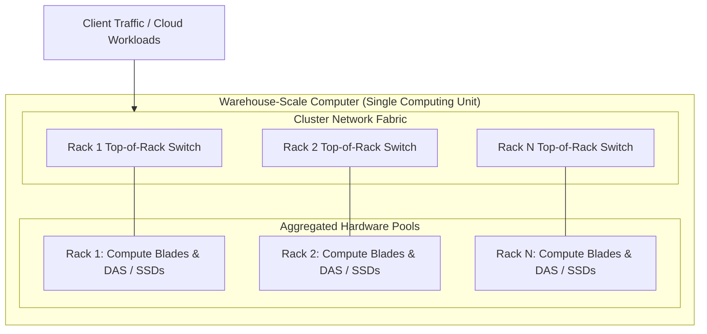

# Warehouse-Scale Computer Architecture: The Datacenter as a Computer

## The Datacenter as a Computer

A WSC is not merely a co-located collection of loose servers. It operates as a single aggregated computing unit executing across tens of thousands of individual server nodes.

This massive aggregation introduces distinct system engineering challenges:
- **Simulation and Testing Constraints**: The immense scale makes full-system hardware simulation or testing impossible prior to deployment; system architects must rely on microbenchmarks and empirical measurement.
- **Fault Dynamics**: Hardware component failures transition from rare anomalies to continuous, expected background events.
- **Microsecond Tail Latency**: Deep storage and network hierarchies introduce performance variability, requiring strict tail-latency tolerance.

## Single Datacenter vs. Multi-Datacenter Topology

Although global services deploy across multiple geographical regions, the fundamental architectural building block remains the **single datacenter WSC**:

- **Single Datacenter Unit**: Optimized for low-latency intra-cluster networking, tight synchronization, and shared cluster storage.
- **Multi-Datacenter Networks**: Used primarily for:
  - *Disaster Tolerance*: Synchronous or asynchronous cross-region replication of non-volatile user data to survive power grid failures or natural disasters.
  - *Edge Content Delivery*: Deploying Content Delivery Networks (CDNs) near end-users for high-bandwidth streaming (e.g., video delivery).

## Industry Standard Terms

| Course Term | Industry / Standard Term |
| :--- | :--- |
| **Top-of-Rack (ToR) Switch** | Leaf Switch / Access Layer Switch |

## Related

- [[Datacenter Systems/Warehouse-Scale Computer Architecture|Warehouse-Scale Computer Architecture]] — Hub for this topic
- [[Datacenter Systems/Warehouse-Scale Computer Architecture/WSCs vs Traditional Datacenters|WSCs vs Traditional Datacenters]] — Differences and cost efficiency at scale
- [[Datacenter Systems/Warehouse-Scale Computer Architecture/Hardware Building Blocks|Hardware Building Blocks]] — Servers, storage, and networking fabric
