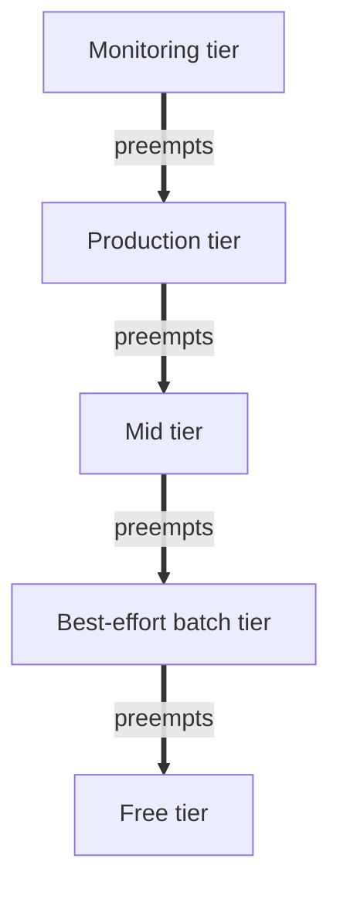
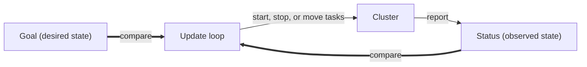

# Datacenter Systems: Orchestration

An **orchestrator** is the operating system for a cluster inside a datacenter: it decides which jobs run on which servers, keeps them running, and provides the services most of them need. This note builds on [[Datacenter Systems/Workloads and Software Infrastructure/Platform and Cluster Infrastructure|Platform and Cluster Infrastructure]] and the [[Datacenter Systems/Containers/Containers|Containers]] that orchestrators schedule.

---

## Settings

- A **cluster** of machines with different capacities:
  - number and power of CPUs, amount of memory, disk and network capacity
- A sequence of arriving **jobs** with different requirements:
  - size of job: the number of parallel nodes
  - estimated amount of CPU, memory, disk, and network needed
  - some jobs are **interactive**, with demand that varies over time
  - others are **batch**, which is delay tolerant

## Cluster Operating System

The orchestrator plays the role of an OS for the whole cluster:

- **Scheduling**: assign jobs to servers
- **Job management**: start, stop, relocate, and pause jobs
- Set up and tear down the virtual network and container file system state
- Standardize the API and file system setup
- Provide common services needed by most containers, so the user can get the job done faster
- Performance and security isolation

Some jobs need to coordinate across clusters and data centers, so we need an OS that coordinates jobs across datacenter sites.

---

## Borg Workload

Borg divides its workload into tiers, ordered here from lowest to highest priority:

| Tier | Priority | Guarantee | What runs there |
|---|---|---|---|
| Free | lowest | no SLO, can be cancelled at any time | leftover resources |
| Best-effort batch (beb) | above free | no SLO, only that it will eventually run | jobs in a queued batch scheduler |
| Mid | above beb | weak SLO; work can still be postponed | weaker workloads |
| Production | high | high availability | user-facing services and storage/networking primitives: the money-making tier |
| Monitoring | highest | must always run | monitoring software that checks everything else is working as intended |

- The monitoring tier has the highest priority, so its demand must be small.
- The production tier is the one that generates revenue, so it is protected the most.

---

## Orchestration Questions

An orchestrator has to answer five questions:

- **How do we keep track of different tasks?**
  - Some might fail, and we need to clean them up.
  - Omega/Kubernetes use a **transactional update** to share orchestration state. It tracks tasks so that we can roll back.
- **How should we structure the API?**
  - Kubernetes uses a **goal/status update loop**: we set a goal, and the system runs and tries to move closer to that goal.
- **What common services are needed?**
- **How should each server OS interact with the orchestrator?**
  - We need to interact with the OS to ensure we are using our resources well.
- **How should we decide which tasks go on which server?**

---

## Orchestrator Services

- **Autoscaling to meet SLOs**
  - **vertical**: acquire or release resources on each node
  - **horizontal**: expand or contract to more nodes, in tandem with a load balancer
  - resource discovery
  - we need to observe the application to see how much we can scale vertically and horizontally
- **Advance warning of preemption or node downtime**: we get warned that we will be preempted, so we can clean up and prepare to stop work.
- **Service monitoring and restart**: runs in the monitoring tier, figures out whether a service is still alive, and brings it back if not.
- **Per-application distributed logging**
- **On failure, isolate the failing node for debugging**
- **Rollout management**

---

## Server OS Interaction with Orchestration

- Linux container support grew in tandem with Borg (see [[Datacenter Systems/Containers/Namespace Isolation|Namespace Isolation]] and [[Datacenter Systems/Containers/Cgroups|Cgroups]]).
- There are **multiple levels of scheduling, often at cross-purposes**: the cluster orchestrator, application threads, and the Linux kernel.
- A **pod** is a collection of processes that represent a container. The system maintains the pod, and its resources, as a unit.
  - We also deploy logging and monitoring alongside the service we are rolling out, in a **subpod**, so they do not interfere with the service.
- **Nested containers**: multiple processes per (outer) container.

---

## Which Task on Which Server

- Borg mixes latency-sensitive and batch tasks on the same server.
- It uses different schedulers for each type of job.
- When we allocate resources, it is better to **over-allocate by 20-30%**. That capacity will sit idle, but it keeps queues from growing long, which would violate the SLA (see [[Datacenter Systems/Queuing Theory/Queuing Theory|Queuing Theory]]).

---

## Related

- [[Datacenter Systems/Workloads and Software Infrastructure/Workloads and Software Infrastructure|Workloads and Software Infrastructure]]
- [[Datacenter Systems/Microservices, RPC, and Cloud Infrastructure/Docker and Kubernetes|Docker and Kubernetes]]
- [[Datacenter Systems/Containers/Containers|Containers]]
- [[Datacenter Systems/Queuing Theory/Queueing and CPU Scheduling|Queueing and CPU Scheduling]]

## Industry Standard Terms

- **Orchestrator** → cluster manager / control plane (Borg, Kubernetes)
- **Goal/status update loop** → declarative reconciliation loop
- **Transactional update to shared orchestration state** → optimistic concurrency control on cluster state (Omega)
- **Pod** → group of co-scheduled containers (Kubernetes pod); **subpod** → sidecar container
- **Vertical / horizontal autoscaling** → scale-up / scale-out
- **Best-effort batch (beb) tier** → batch / preemptible priority class
- **Monitoring tier** → system-critical priority class
