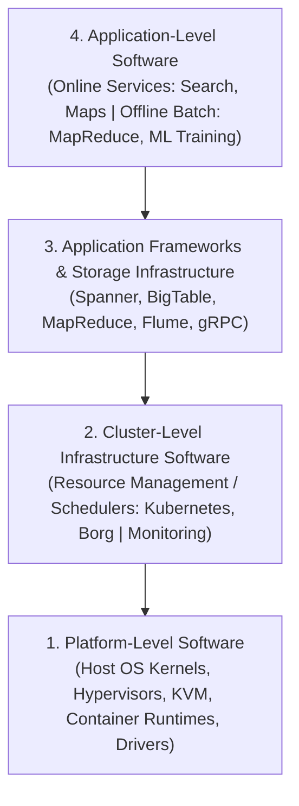

# Workloads and Software Infrastructure: Software Taxonomy and Trade-offs

## Workloads and Software Infrastructure Motivation & Overview

Warehouse-scale computing hardware requires a software stack capable of choreographing tens of thousands of server nodes while masking hardware failures, optimizing resource multiplexing, and enforcing microsecond latency targets.

### WSC Software Taxonomy

Software operating in a WSC is partitioned into four distinct functional tiers:

1. **Platform-Level Software**: Firmware, OS kernels, device drivers, and virtualization hypervisors present on individual server nodes to abstract single-machine hardware.
2. **Cluster-Level Infrastructure Software**: Distributed systems software that manages global hardware resources, task scheduling, distributed storage, RPC messaging, and synchronization. Functions as the **datacenter operating system**.
3. **Application Frameworks & Storage**: High-level abstractions (e.g., MapReduce, Spanner, BigTable) that automate data partitioning, state replication, and distributed execution.
4. **Application-Level Software**: End-user services classified into:
   - *Online Services*: Latency-critical, user-facing services (e.g., web search, ad serving).
   - *Offline Computations*: Throughput-oriented batch analytics (e.g., index building, log processing, model training).

### Datacenter vs. Desktop Software Trade-offs

Developing software for warehouse-scale environments introduces operational characteristics distinct from desktop software engineering:

- **Ample Parallelism**:
  - *Data-Level Parallelism*: Large datasets partitioned across thousands of independent records, allowing sub-tasks to run concurrently while hiding network synchronization latencies.
  - *Request-Level Parallelism*: High query throughput (hundreds of thousands of requests per second) where individual user requests execute independently without shared-memory locks.
- **Workload Churn and Rapid Deployment**: Users interact with cloud backends via stable web APIs, enabling continuous software deployment (CD) without customer software updates.
- **Platform Homogeneity**: WSCs standardize on a narrow set of server hardware configurations, simplifying kernel driver validation, cluster scheduling, load balancing, and automated hardware replacement.
- **Fault-Prone Execution Environment**: Hardware component failure is a continuous operational state rather than an exceptional edge case. Software must operate seamlessly across failing nodes.

## Industry Standard Terms

| Course Term | Industry / Standard Term |
| :--- | :--- |
| **Platform-Level Software** | Host System Software / Node OS Runtime / KVM Layer |
| **Cluster-Level Infrastructure** | Datacenter OS / Container Orchestrator (Kubernetes / Borg) |
| **Application Framework** | Distributed Processing Framework (MapReduce / Spark / Ray) |
| **Live Migration** | Zero-Downtime VM Evacuation / Memory Pre-Copy |

## Related

- [[Datacenter Systems/Workloads and Software Infrastructure|Workloads and Software Infrastructure]] — Hub for this topic
- [[Datacenter Systems/Workloads and Software Infrastructure/Platform and Cluster Infrastructure|Platform and Cluster Infrastructure]] — Platform-level and cluster-level software
