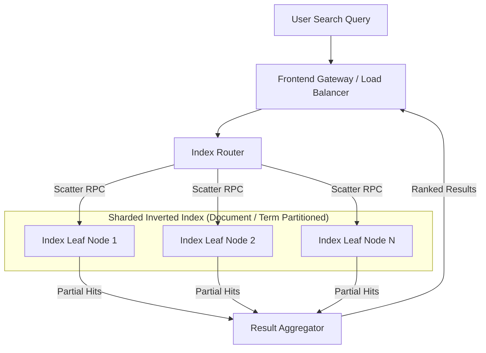

# Workloads and Software Infrastructure: Workload Diversity

## Workload Diversity & Production Application Mechanics

### Web Search Application Architecture
Web search demands sub-second total latency across massive index datasets:

- **Index Partitioning**: Indices are sharded by document ID or term across thousands of leaf nodes.
- **Latency & Throughput Balance**: Must respond within milliseconds while handling diurnal load swings (where trough query rates are less than half of peak volume). Auto-scaling dynamically adjusts leaf replica pools.

### Video Serving Pipelines
Video processing balances compute, storage, and networking costs based on content popularity profiles:

![[Screenshots/YouTube Video Processing Pipeline.png]]

- **Transcoding Pipeline**: Raw video uploads are ingested and converted into diverse codec combinations, resolutions, and frame rates for heterogeneous mobile/desktop client devices.
- **Cost Balancing**: Popular videos are pre-transcoded and cached at edge CDNs to reduce compute and egress latency; long-tail unpopular videos are transcoded on-demand to save storage capacity.

## Related

- [[Datacenter Systems/Workloads and Software Infrastructure|Workloads and Software Infrastructure]] — Hub for this topic
- [[Datacenter Systems/Workloads and Software Infrastructure/Platform and Cluster Infrastructure|Platform and Cluster Infrastructure]] — Platform-level and cluster-level software
- [[Datacenter Systems/Workloads and Software Infrastructure/Cloud Stack and Performance Toolbox|Cloud Stack and Performance Toolbox]] — Multi-tenancy and the performance and availability toolbox
